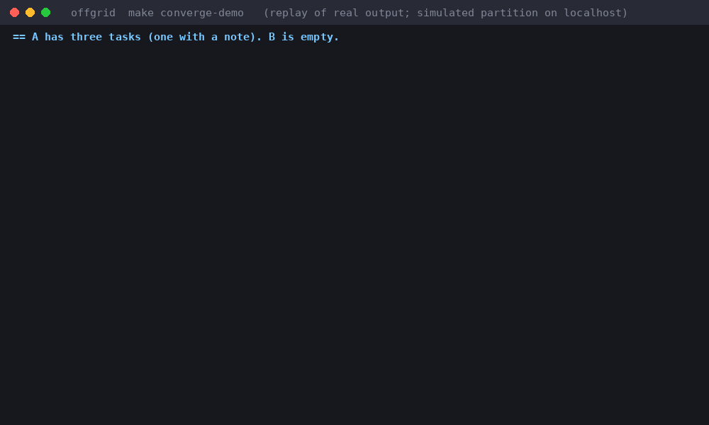
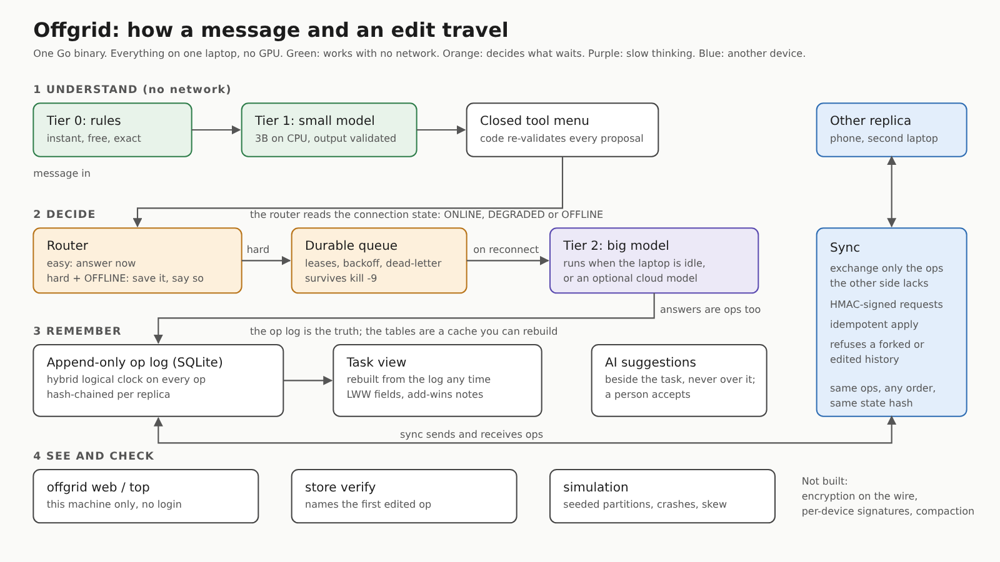

# Offgrid

[](../../actions/workflows/ci.yml)
[](https://go.dev/)
[-brightgreen)](https://github.com/Rebira678/Offgrid-AI)
[](LICENSE)

**An AI agent runtime that keeps working when the internet doesn't.**

A small local model makes instant decisions, a durable queue holds the hard
thinking until a connection returns, and replicas that were apart merge their
edits deterministically when they meet again. Everything runs on one laptop
with no GPU and costs $0.

> Status: **Day 30: Launch, feature freeze since Day 26.** Tasks are logged, updated and
> reviewed offline; the data survives restarts and `kill -9`; the program knows
> whether it is ONLINE, DEGRADED or OFFLINE; hard requests wait in a durable
> queue; two replicas that edited the same task apart end with identical state
> hashes; an edited log is noticed. **Not yet tested on real devices or a real
> network:** sync has only run on localhost, with the cut simulated by fault
> injection. See [Honest limits](#honest-limits).



*`make converge-demo`, replayed from its real output (about 12 seconds to run).
The partition is simulated on localhost, not real WiFi.*

Contributions are welcome: see [CONTRIBUTING.md](CONTRIBUTING.md) and the
[good first issues](docs/good-first-issues.md).

Read next: [the architecture](ARCHITECTURE.md) (guarantees, each with the test
that enforces it) and [Why I used CRDTs for an AI agent](docs/article-why-crdts-for-an-ai-agent.md) (draft).

## Quickstart: three commands

```bash
sudo apt install -y build-essential golang   # once: C compiler (for SQLite) and Go 1.22+
make build && make test                      # 1. build and test
scripts/demo-offline.sh                      # 2. see it work with no network and no model
```

That demo logs tasks, restarts, shows them again, then deletes the task table
and rebuilds it from the log. Nothing in it needs Ollama or the internet.

Want the language model too (Tier 1, for messages the rules do not understand)?

```bash
curl -fsSL https://ollama.com/install.sh | sh && scripts/pull-models.sh
./bin/offgrid agent -seed                    # type messages; shows which tier answered
```

Without a model, `offgrid agent -no-model` still handles everything the rules
cover, and says so politely for the rest.

## Install

Tagged releases publish a Linux binary for amd64 and arm64 with a `SHA256SUMS`
file (Releases page). The binary is dynamically linked against glibc (SQLite is
compiled in), and is built on Ubuntu 22.04, so it needs glibc 2.35 or newer (Ubuntu 22.04+, Debian 12+).

```bash
sha256sum -c --ignore-missing SHA256SUMS
tar xzf offgrid-vX.Y.Z-linux-amd64.tar.gz && ./offgrid-vX.Y.Z-linux-amd64/offgrid version
```

Or build it yourself with `go build ./cmd/offgrid` (Go 1.22+, a C compiler).
Nothing here has been run on macOS or Windows; see the first good first issue.

## Architecture



Each guarantee, the test that enforces it, and what is not built yet:
[ARCHITECTURE.md](ARCHITECTURE.md).

## Design decisions and trade-offs

Each of these cost something. The cost is stated next to the choice.

| Decision | Why | What it costs |
|---|---|---|
| **The op log is the truth; tables are a cache.** Every change is an immutable op; the task view is rebuilt from the log. | Crashes, merges and audits all reduce to "replay the log". `kill -9` cannot corrupt the answer. | The log only grows (no compaction yet). Rebuilding replays everything: see the benchmark table for the time at 10,000 ops. |
| **A small CRDT written here, not a library.** Per-field last-writer-wins for tasks, an add-wins set for notes. | Small enough to prove: property tests for commutative, associative and idempotent merges, and a seeded simulator that found a real bug on its first run. | It is not battle-tested like an established library, and it does less (no text merging, no moves). |
| **A hybrid logical clock, not wall clocks.** | A phone's clock can be wrong, slow, or go backwards. The HLC keeps order monotonic anyway. | A replica whose clock is far in the future is refused (more than an hour ahead), and ties are broken by device name, which is deterministic but arbitrary. |
| **The model proposes, the code disposes.** A closed menu of tools; every proposed command is re-validated. | A small model can be wrong and still be safe, as long as nothing it says is trusted. | It can only do what is in the menu. Precision over coverage: when unsure it asks or refuses. |
| **Rules first, small model second, big model last.** Tier 0 is instant and free; Tier 1 is a 3B model on CPU; Tier 2 runs only when the laptop is idle. | Most messages never touch a model; a small model handles the common phrasing; the slow model never competes with the user for the machine. | Three paths to maintain, and the rules only cover what someone wrote them for. |
| **Durable queue before slow thinking.** Defer the hard work to a worker, with backoff and leases in SQLite. | The user gets an instant answer ("queued"); a crash during a long task loses nothing. | The answer is not immediate; the user has to look in the queue or wait for sync. |
| **An AI never overwrites a human.** Model output becomes a *suggestion* beside the task. | A hallucination or a stale model edit cannot destroy real field notes. A person has to accept it. | Suggestions pile up if ignored; accepting is an extra step. |
| **A single binary with zero runtime dependencies.** No npm, no external daemon, embedded dashboard. | Copy one file, run it; works on an airplane or a mine site. | The binary is ~20 MB (with SQLite compiled in); the web UI is plain HTML/CSS (no React, no CDN). |

## Benchmarks

All numbers below were measured directly on the hardware named here with `offgrid bench`,
`offgrid eval -ablation` and `offgrid agent -eval` (copied from `docs/benchmarks.md` and the Day 3 and Day 5 reports). Rerun them
on your own machine: `make bench` (speed, sync, queue, memory), `offgrid eval -ablation`, `offgrid agent -eval`.

**Hardware:** HP EliteBook 845 G8, AMD Ryzen 5 PRO 5650U (6 cores / 12 threads),
14.9 GiB RAM, no GPU used for inference. Zorin OS 18.1.

<!-- bench:start -->
**Speed** (`offgrid bench`, median of 3 runs, long prompt = 1,176 tokens):

| Model | Prompt | Load (s) | First token (s) | Generation (tok/s) | Prompt processing (tok/s) |
|---|---|---|---|---|---|
| llama3.2:1b | short | 3.3 | 0.7 | 16.0 | 88.0 |
| llama3.2:1b | long | 3.3 | 23.7 | 13.9 | 49.7 |
| llama3.2:3b | short | 0.0 (already loaded) | 1.0 | 9.9 | 61.5 |
| llama3.2:3b | long | 0.0 (already loaded) | 16.5 | 9.0 | 71.8 |
<!-- bench:end -->

**Storage & CRDT Replay Throughput** (`make bench-store`):

| Operation | Scale | Latency / Rate | Architectural Guarantees |
|---|---|---|---|
| **Committed Write** (`BenchmarkAppend`) | 1 op | **910 µs / op** (~1,100 ops/s) | Full WAL flush (`PRAGMA synchronous=FULL`), trigger check, and view update. |
| **Rebuild View** (`BenchmarkRebuild`) | 1,000 ops | **23.1 ms** (~43,000 ops/s) | In-memory reconstruction of full materialized view from scratch. |
| **Rebuild View** (`BenchmarkRebuild`) | 10,000 ops | **233.6 ms** (~42,800 ops/s) | Entire dataset reconstructed in under a quarter of a second. |
| **Rebuild View** (`BenchmarkRebuild`) | 50,000 ops | **1.15 s** (~43,500 ops/s) | 50,000 historical ops replayed in barely over 1 second. |
| **CRDT Register Projection** (`BenchmarkFields`) | 10,000 ops | **26.0 ms** (~384,000 ops/s) | Reads op-log and folds into LWW-Map per-field registers with single allocation. |
| **HLC Timestamp Issue** (`BenchmarkNow`) | 1 op | **55.4 ns** (~18,000,000 ops/s) | Thread-safe, monotonic, causal timestamp issuance (0 allocs). |
| **CRDT Merge (Small)** (`BenchmarkMergeSmall`) | 4 fields | **345 ns** (~2,900,000 merges/s) | Pure semilattice join over per-field registers. |

**Reliability** (`offgrid eval -ablation`, 30 labelled messages; 95% Wilson intervals in brackets):

| Model | Setup | Clean JSON | Valid after retries | Intent correct | Arguments correct |
|---|---|---|---|---|---|
| 1b | prompt only | 60% [42-75] | 60% [42-75] | 57% [39-73] | 56% [37-73] |
| 1b | + schema | 100% [89-100] | 87% [70-95] | 83% [66-93] | 84% [65-94] |
| 1b | + schema + retries | 100% [89-100] | 97% [83-99] | 93% [79-98] | 92% [75-98] |
| 3b | prompt only | 73% [55-86] | 73% [55-86] | 73% [55-86] | 76% [57-89] |
| 3b | + schema | 100% [89-100] | 93% [79-98] | 90% [74-97] | 92% [75-98] |
| 3b | + schema + retries | 100% [89-100] | 100% [89-100] | 97% [83-99] | 100% [87-100] |

**Tiers** (`offgrid agent -eval`, same 30 messages): Tier 0 rules handled 16 of 30
(all 16 correct: 11 done, 5 refused) in a median 19 microseconds; the 3B model
handled the other 14 in a median 2.2 s (11 done, 3 declined). The Tier 0 split
was reproduced independently; the model timings were not (no model server in
the reviewing sandbox). The Tier 2 (7-8B) model has no row yet: run it with
`offgrid bench -models qwen2.5:7b` and add it.

**System costs** (no model involved; `make bench` regenerates this block, and its Hardware
line says which machine produced it):

<!-- perf:start -->
**Hardware:** AMD Ryzen 5 PRO 5650U with Radeon Graphics, 12 threads, 14.9 GiB RAM, Zorin OS 18.1  
**Run:** 2026-10-30, go1.26.5, median of 3 runs (min to max in brackets), seed 1, files in `/tmp/offgrid-perf-1295714907` (ext4), CPU governor `performance`. No model is involved in these numbers.

**Store** (one SQLite file, `synchronous=FULL`: every write is on disk when it returns):

| What | Ops | Time (s) | Ops/s | File (MiB) | Peak Go heap (MiB) | Peak RSS (MiB) |
|---|---|---|---|---|---|---|
| append (one durable write per op) | 1,000 | 0.999 [0.996 to 1.00] | 1,001 | 0.3 | 3.6 | 21 |
| open an existing log | 100 | 0.0009 [0.0007 to 0.0011] | - | 0.1 | 0.9 | 21 |
| rebuild the view from the log | 100 | 0.0094 [0.0087 to 0.010] | 10,653 | 0.1 | 1.4 | 20 |
| open an existing log | 1,000 | 0.0007 [0.0007 to 0.0010] | - | 0.3 | 0.9 | 23 |
| rebuild the view from the log | 1,000 | 0.074 [0.071 to 0.076] | 13,480 | 0.3 | 3.2 | 24 |
| open an existing log | 10,000 | 0.0007 [0.0007 to 0.0009] | - | 2.3 | 1.0 | 24 |
| rebuild the view from the log | 10,000 | 0.663 [0.658 to 0.691] | 15,080 | 2.3 | 5.2 | 27 |

**Sync** (the replica that catches up must end with the same state hash as its source, or the run fails):

| What | Ops | Time (s) | Ops/s | HTTP requests | Peak Go heap (MiB) | Peak RSS (MiB) |
|---|---|---|---|---|---|---|
| new replica, in process | 100 | 0.0084 [0.0080 to 0.0085] | 11,850 | - | 1.6 | 23 |
| new replica, HTTP on localhost | 100 | 0.011 [0.0096 to 0.011] | 9,467 | 2 | 1.9 | 22 |
| 10 new ops on a 100-op log, HTTP | 10 | 0.0027 [0.0027 to 0.0034] | 3,664 | 2 | 1.3 | 23 |
| new replica, in process | 1,000 | 0.078 [0.074 to 0.083] | 12,834 | - | 3.6 | 25 |
| new replica, HTTP on localhost | 1,000 | 0.079 [0.077 to 0.080] | 12,735 | 3 | 3.5 | 25 |
| 10 new ops on a 1,000-op log, HTTP | 10 | 0.0032 [0.0030 to 0.0033] | 3,170 | 2 | 1.2 | 24 |
| new replica, in process | 10,000 | 0.838 [0.832 to 0.848] | 11,937 | - | 3.6 | 28 |
| new replica, HTTP on localhost | 10,000 | 0.888 [0.887 to 0.893] | 11,258 | 21 | 3.7 | 28 |
| 10 new ops on a 10,000-op log, HTTP | 10 | 0.0089 [0.0082 to 0.012] | 1,126 | 2 | 1.2 | 27 |

**Queue** (jobs that do nothing, so this is the queue's own cost: claim, run, complete, each a durable write):

| Jobs | At a time | Enqueue (s) | Drain (s) | Jobs/s drained | Peak Go heap (MiB) | Peak RSS (MiB) |
|---|---|---|---|---|---|---|
| 100 | 1 | 0.087 [0.081 to 0.087] | 0.186 [0.181 to 0.197] | 539 | 2.7 | 25 |
| 100 | 4 | 0.089 [0.084 to 0.091] | 0.182 [0.181 to 0.193] | 550 | 2.7 | 25 |
| 1,000 | 1 | 0.763 [0.759 to 0.766] | 1.70 [1.70 to 5.21] | 588 | 3.5 | 27 |
| 1,000 | 4 | 4.00 [4.00 to 4.03] | 8.19 [8.18 to 8.23] | 122 | 3.2 | 26 |

Peak RSS is the largest resident memory of the whole process during that row (counter reset before each row). Peak Go heap is sampled every 10 ms, so a very short spike can be missed. Sync over HTTP runs on one machine: it measures protocol, signing and storage cost, not a WiFi link.
<!-- perf:end -->

## Honest limits

- **No real devices, no real network.** Everything ran on one HP EliteBook
  over localhost. Network cuts are simulated by the fault-injection transport.
  [`docs/real-device-report.md`](docs/real-device-report.md) is where the first
  real-device results go (a second machine, real WiFi, router and power cuts, a
  cold-boot clock). Until a row there is filled in with a date and the hardware,
  it has **not** run on real hardware. `offgrid doctor` and `make kill9-test` check
  a node before and after; a killed process is not a power cut.
- **Sync is signed, not encrypted** (HMAC with a shared key). Use a trusted
  network or put TLS in front. The signature has a five-minute clock window,
  and an op stamped more than an hour in the future is refused.
- **Deleting is not final against unseen edits:** an edit made by a replica that
  had not seen the delete brings the task back (add-wins). Only the command
  line deletes; the language model cannot.
- **Task IDs carry the device that made them (Day 24).** `T3.laptop`; screens
  show `T3` and `T3` still finds it when exactly one task has that number. This
  fixed a bug the simulator found: two devices that each created a first task
  before meeting both chose `T1` and could never sync. Databases written before
  Day 24 still hold plain IDs; two such databases that collided are still refused
  with a clear error, and nothing is changed.
- **The simulation checks convergence and two recomputed rules** (delete vs edit,
  first resolution of a suggestion), not every meaning. A store that converged
  on a wrong answer the oracles do not recompute would pass. It models neither a
  disk that loses committed writes, nor a replica restored from an old backup
  (that forks the log, which sync refuses on purpose), nor a hostile peer.
- **The dashboard (Day 26) is for this machine only.** It has no login and no
  encryption, so it refuses any address but 127.0.0.1, ::1 or localhost, and any
  request whose Host is not one of those (DNS rebinding) or that comes from
  another site. Anyone who can use a browser on your computer can use it: accept
  and dismiss included (`-read-only` removes those). To see the dashboard from a
  phone, sync to the phone and run it there. It was checked in Chromium only, by
  me, not on your laptop, and not with a screen reader. It polls every 2 seconds;
  there is no history, only what the log, the queue and the published snapshots
  hold right now.
- **Tamper-evident, not tamper-proof (Day 27).** Editing, deleting or reordering
  an op without rewriting what follows makes `offgrid store verify` fail and name
  the op. Someone who can write the file can also recompute every later hash and
  rebuild the view; that passes `verify` on its own. It is caught by a head you
  saved elsewhere (`store head`, then `verify -anchor FILE`) or the next time that
  replica syncs with one that kept the real history. Without one of those, a
  full rewrite is invisible. Databases from before Day 27 are chained when first
  opened, so edits made before then cannot be seen. The chain is not
  authentication: it does not say who made an op, and HMAC sync is still a shared key.
- **The log only grows.** No compaction of old ops or tombstones.
- **Model numbers are one laptop, one run.** Small samples (30 messages): read
  the intervals, not the point values. The 7-8B Tier 2 model is not in the tables.
- **Suggestions (Day 23) protect against edits made AFTER a suggestion is made,**
  and only edits this device has received. An edit made on another device that
  has not synced yet cannot be seen; once it syncs, the suggestion turns stale.
  Staleness is about status and priority; a suggested note is never stale. A
  queued message that updates a task is read hours later by a model, and what the
  task looked like at that moment is what the suggestion remembers.
- **Tier 2 (Day 22) is tested with stand-in models,** not a real 7-8B model or a
  real cloud API. The idle gate looks at CPU use only (Linux `/proc/stat`; on
  other systems it never blocks). The cloud client is off unless configured, and
  sends your task data to the URL you give it. An answer is a fact in the log:
  asking again the next day makes a new answer, and old ones are never rewritten.
- Upgrade both replicas together: an older replica refuses ops it does not know.

## What's next

Only what is already known to be missing; nothing here is promised by a date.

- **A real network and real devices.** Everything ran on one laptop over localhost.
  Two real devices on a real WiFi link is the test that matters most.
- **Read-only commands that create a database.** Opening a path that does not exist
  creates it, under a random node name, even for a command that only reads (found
  by the Day 29 clean-copy test; the demo script now names its node).
- **Authentication per device** (signing keys), and encryption on the wire.
- **Compaction** of old ops and tombstones.
- **A 7-8B Tier 2 model in the tables**, and the same benchmarks on other hardware.
- **macOS and Windows.** Linux only so far; the first good first issue is a macOS test run.
- **The long-form article** ([draft](docs/article-why-crdts-for-an-ai-agent.md)), published and linked here.

Feature work after launch goes through issues; see [CONTRIBUTING.md](CONTRIBUTING.md).

## What works today

| Day | What | Try it |
|---|---|---|
| 1 | Measure local model speed honestly | `offgrid bench` |
| 2 | Streaming client, typed errors | `offgrid ask "..."` |
| 3 | Free text to a validated command | `offgrid parse "close the pump ticket"` |
| 4 | Closed tool menu, code re-validates what the model proposes | `offgrid exec -seed '{"intent":"list_tasks"}'` |
| 5 | Tier 0 rules first, model second | `offgrid agent -seed -no-model` |
| 6 | Event-sourced SQLite store: append-only op log plus a rebuildable view | `offgrid store -db FILE verify` |
| 7 | Automated offline demo & developer test harness | `make demo` / `make check` |
| 8 | Connectivity monitor: ONLINE / DEGRADED / OFFLINE with hysteresis | `offgrid net` |
| 9 | Durable job queue: backoff with jitter, idempotency keys, leases, dead-letter | `offgrid queue stats` |
| 10 | Router: answer now, or save hard requests in the queue with a visible status. **Checkpoint 1** | `offgrid agent -route -net offline` |
| 11 | A switch to break your own network: injected latency, packet loss and partitions | `scripts/partition-demo.sh` |
| 12 | Drain on reconnect, survive a crash: worker with concurrency limit, leases, checkpoints, stored results | `scripts/drain-demo.sh` |
| 13 | See the system: `log/slog` logs, counters, and a one-screen live view of connection, queue and tiers | `scripts/top-demo.sh` |
| 14 | Recap: `ARCHITECTURE.md` v1, release v0.1 | `ARCHITECTURE.md`, `scripts/release-v0.1.sh` |
| 15 | Hybrid logical clock: stamps that survive slow, fast and backwards clocks | `offgrid clock demo` |
| 16 | LWW-Map: per-field last-writer-wins registers, pure merge, node-ID tie-break | `offgrid lww demo` |
| 17 | Property tests (`rapid`): merge is commutative, associative, idempotent; broken merges are caught | `scripts/prove-merge.sh` |
| 18 | OR-Set: add-wins observed-remove set with tombstones (notes, task lists) | `offgrid orset demo` |
| 19 | Sync protocol: version summaries, delta exchange, idempotent apply, HMAC auth | `offgrid sync serve` / `once` |
| 20 | **Checkpoint 2:** two replicas edit offline (chaos switch), reconnect, state hashes match; delete task / note | `make converge-demo` |
| 21 | Recap: README, the long-form article draft, the re-cut flagship video plan | `docs/day-21.md` |
| 22 | Tier 2, slow thinking: a big local model that runs only when the laptop is quiet, an optional cloud model, answers written back as synced ops | `make two-brains-demo` |
| 23 | The AI never overwrites a human: AI output is a suggestion beside the task; accepting is an explicit op, refused if a person edited since | `make ai-suggests-demo` |
| 24 | Deterministic simulation: seeded schedules of partitions, clock skew, crashes and lossy sync against the real store; a failing seed replays exactly. It found a real bug on its first run | `make sim` |
| 25 | Reproducible benchmarks: store, sync, queue drain and memory with the hardware stated; `make bench` rewrites the tables below | `make bench` |
| 26 | Web dashboard from the single binary (`embed`): replicas and merges, connection, queue, tiers, tasks, and Accept / Dismiss for AI suggestions. This machine only. **Feature freeze** | `make web-demo` |
| 27 | Tamper-evident log: every op is hash-chained to the previous op of the same replica; `store verify` names an edited op; saved heads and sync catch a rewritten chain | `make tamper-demo` |
| 28 | Ship-ready repo: CI on Go 1.22/stable, release workflow (amd64/arm64), linters, licence, starter issues | `make lint` / `make release-local` |
| 29 | Front page that works: visual architecture, trade-off matrix, fresh-clone test harness, demo replay GIF | `make fresh-test` / `make demo-gif` |
| 30 | Launch: pre-flight launch verification, personalized outreach drafts, claims ledger | `make launch-check` / `docs/day-30.md` |
| 31 | Reads never create a database (typed `ErrNoDatabase`, exit 3); one-page product spec; merge packages kept buildable as WebAssembly | `make wasm-test` / `docs/day-31.md` |
| 32 | Real-device kit: `offgrid doctor`, a power-pull test with acknowledgements kept off the node, timeouts on network calls | `offgrid doctor` / `docs/day-32.md` |

Keep tasks between runs with `-db FILE` (or `export OFFGRID_DB=~/offgrid/tasks.db`).

## Layout

```
cmd/offgrid/            the CLI: models, bench, ask, parse, eval, exec, tools, agent, store, task, net, queue, drain, answers, suggestions, fault, top, clock, lww, orset, sync, doctor
internal/ollama/        HTTP client for Ollama: streaming, typed errors
internal/bench/         benchmark method and report writers
internal/sysinfo/       reads CPU and RAM so every result names its hardware
internal/intent/        the Command type and its validation
internal/structured/    getting valid JSON out of a model, with retries
internal/llm/           the interface models sit behind (Ollama, OpenAI-compatible cloud, fake)
internal/eval/          measures how reliably models produce valid commands
internal/task/          the Task type, matching rules, the Store contract
internal/task/storetest shared contract tests every store must pass
internal/tools/         the closed menu of tools and the registry
internal/agent/         tiered loop: rules first, model second
internal/store/sqlstore SQLite store: op log, migrations, rebuild, verify
internal/doctor         field-readiness checks: clock, disk, ports, SQLite integrity (read-only)
internal/connectivity   state machine, probers and the monitor goroutine
internal/jobqueue       durable job queue: backoff, jitter, leases, dead-letter
internal/router         answer now or defer: complexity gate, output validity, connectivity
internal/netfault       fault-injecting http.RoundTripper: latency, drop %, partition (file, schedule, flag)
internal/drain          queue worker: concurrency, network gate, leases, release, checkpoints; job handlers
internal/obs            structured logs (slog), counters, snapshot files other processes can read
internal/dash           the one-screen view: a pure render function plus a repaint loop
internal/hlc            hybrid logical clock (Kulkarni et al.): ordering stamps that survive bad clocks
internal/crdt           LWW-Map (per-field registers) and OR-Set (add-wins sets): pure, order-independent merges
internal/web            the dashboard: one embedded page, a JSON state endpoint, and the one write it allows (accept or dismiss a suggestion), guarded for localhost
internal/sim            deterministic simulation: a seed becomes a failure schedule (partitions, skew, crashes, lossy sync) run against the real store
internal/perf           reproducible benchmarks: store, sync, queue drain, memory, hardware recorded (make bench)
internal/suggest        the wall between AI output and a person's tasks: updates and notes become suggestions
internal/idle           is the CPU quiet? (the gate for slow jobs; reads /proc/stat)
internal/syncer         sync over HTTP: version summaries, delta exchange, HMAC-signed requests and responses
scripts/                pull-models.sh, demo-offline.sh, checkpoint1-demo.sh, partition-demo.sh, drain-demo.sh, top-demo.sh, web-demo.sh,
                        release-v0.1.sh, prove-merge.sh, sync-demo.sh, converge-demo.sh, converge-clip.sh, two-brains-demo.sh, ai-suggests-demo.sh,
                        create-good-first-issues.sh, fresh-clone-test.sh, render-demo-gif.py, launch-check.sh, outreach-drafts.py, wasm-check.sh
examples/               sample command and message files
docs/                   day-NN.md guides, architecture specifications, benchmarks, and article drafts
```

## Tests

As of Day 30, `go test -v ./...` runs all test functions (plus their subtests)
in 28 packages: over 22,000 lines of Go and over 24,000 lines of tests. One
test skips by design (a helper process that only runs when launched by another
test). Day 17 and later need `go get pgregory.net/rapid@v1.2.0` once.

```bash
make check                 # vet + gofmt + tests
make lint                  # golangci-lint (the config CI uses)
go test -race ./...        # with the race detector
scripts/prove-merge.sh     # the merge laws, and the broken merges they must catch
make fresh-test            # fresh-clone build, test, and demo harness (timed under 10m)
make launch-check          # Day 30 pre-flight readiness checks
make wasm                  # Day 31: verify CRDT & HLC build for WebAssembly
make wasm-test             # Day 31: run merge tests under WebAssembly via Node.js
```

### Quality Guarantees

- **Deterministic Simulation Testing:** Seeded pseudo-random failure schedules (clock skew, network partitions, worker crashes, message drop) verify eventual consistency and CRDT convergence against reference models.
- **CRDT Mathematical Laws:** Automated property-based tests via Rapid verify Commutativity ($A \cup B = B \cup A$), Associativity ($(A \cup B) \cup C = A \cup (B \cup C)$), and Idempotence ($A \cup A = A$). Deliberately broken operations fail fast.
- **Cryptographic Tamper-Evident Hash Chain:** SHA-256 chain per replica with SQLite trigger protection (`op_chain`). `offgrid store verify` detects altered or reordered ops, `-anchor` compares heads against external checkpoints, and remote sync refuses an op built on an edited history with HTTP 409 conflict code `chain` (`make tamper-demo`).
- **Crash-Resilience Testing (`kill -9`):** Subprocess-level SIGKILL injection tests verify that killed workers in mid-execution leave no leaked leases, duplicate results, or corrupted state.
- **UTF-8 Boundary Safety:** Truncation guards ensure multi-byte UTF-8 runes (Japanese, Amharic, Emoji) crossing the 8KB limit are never bisected, preventing JSON encoding or SQLite projection errors.
- **Race Detection:** Clean under `go test -race ./...`.
- **Adversarial & Tamper Testing:** Unit tests deliberately corrupt SQLite database rows and assert that `Verify` detects the divergence and `Rebuild` restores cryptographic parity.

## Licence

[MIT](LICENSE). Copyright (c) 2026 Rebira.
