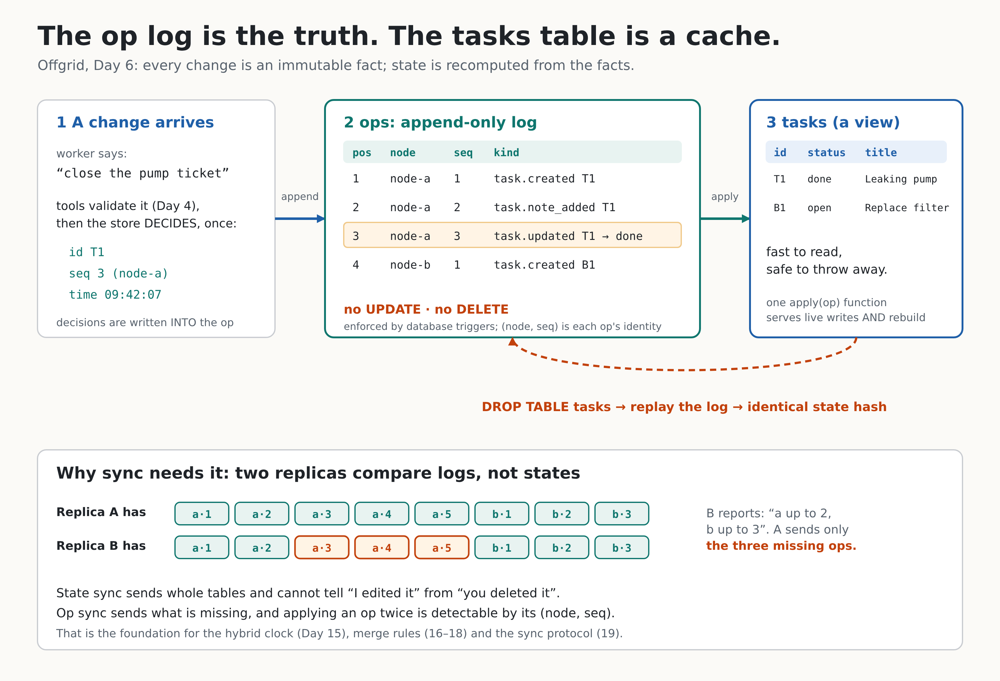

# Day 6: Event-sourced storage



Until today, tasks lived in memory (`MemStore`) and disappeared when the program ended. Day 6 adds a real database, but not the usual kind. We store **what happened**, not **what is true now**.

## The idea in one paragraph

A normal app keeps a `tasks` table and overwrites a row when a task changes. The old value is gone. Offgrid instead appends an immutable **op** to a log for every change ("task T1 was created", "T1 became done"). The `tasks` table still exists, but it is a **view**: a cache computed by replaying the log. Delete it and you can rebuild it, byte for byte, from the log.

**Done when:** delete the materialized table, rebuild from ops, get identical state. This is tested (`TestRebuild...` in `internal/store/sqlstore`) and you can do it yourself below.

## Concepts

**Facts vs state.** "T1 is done" is state; it was true after a change and might change again. "At 09:42 node-a marked T1 done" is a fact; it stays true forever. Facts are easy to share between machines. State is not: two machines with different state cannot tell who is right.

**The log is the truth, the tables are a cache.** Anything in the `tasks` and `task_notes` tables can be thrown away. Only `ops` (and `meta`) are precious. That is why only those have migrations.

**`apply(op)` is a pure function of the op.** Everything the change needs (the new task ID, the sequence number, the timestamp) is decided once, at write time, and stored *inside* the op. Replay never calls the clock or counts rows, so replaying gives the same answer every time. If apply asked "what time is it?", rebuild would give different state today than yesterday.

**One `applyOp`.** Live writes, `Rebuild` and `Verify` all go through the same function. There is no second code path that could drift.

**Op identity is `(node_id, seq)`.** Each node numbers its own ops 1, 2, 3 with no gaps. The local `pos` column is just the order *this* database applied them. `Verify` checks the sequences are gapless. A gap means something was lost.

**Atomic append + apply.** The op insert and the view update happen in one transaction. A failed write leaves no op and no gap in `seq`.

**Append-only is enforced by triggers.** `BEFORE UPDATE` and `BEFORE DELETE` triggers on `ops` raise an error. This protects against bugs and accidents. It does not stop someone with root who runs `DROP TABLE`; no database trigger can.

**Two kinds of versioning.**
- *Migrations* (`schema_migrations`) change the source of truth (`ops`, `meta`). Each runs in its own transaction. A database from a newer Offgrid is refused (`ErrNewerSchema`) instead of being damaged.
- *`projectionVersion`* describes how the view is computed. If it changes, `Open` rebuilds the view automatically. No migration needed, because the view is disposable.

**The state hash.** `StateHash` is sha256 of a canonical JSON form of the view. Equal hash means equal state. `Verify` replays the log into a scratch in-memory database and compares hashes with the live view; a mismatch means the view was tampered with or has a bug. On Day 20 the same hash will prove two replicas converged.

**Strict decoding.** Op payloads are decoded with `DisallowUnknownFields`, and an unknown op kind is *refused*, not skipped. Skipping would silently produce a different state than the writer intended.

## Why sync needs this

Two replicas can compare logs: "I have node-a up to 2 and node-b up to 3." The other side sends only the missing ops. Applying an op twice is detectable by `(node, seq)`. Sending state cannot say whether a missing row was deleted or never arrived. This is the base for the hybrid clock (Day 15), merge rules (16-18) and the sync protocol (19).

## Known limitations (honest list)

- Task IDs are `T<n>`, unique **per replica only**. Two replicas can both create `T1`. Fixing that is a sync problem for later.
- The op timestamp `ts` is wall-clock for now. Day 15 replaces it with a hybrid logical clock.
- The SQLite driver (`mattn/go-sqlite3`) uses cgo, so you need a C compiler and the first build is slow (about a minute). It is isolated in `driver.go`, so swapping in a pure-Go driver later touches one file. I did not test a pure-Go driver.
- Nothing here ran against real Ollama. The agent still works with the Tier 0 rules; model results are unchanged from earlier days.

## Go lessons

- **Small interface for "DB or transaction".** `execer` (Exec/Query/QueryRow) lets the same function run inside or outside a transaction.
- **Differential testing with an oracle.** `MemStore` is simple and obviously correct. A seeded random workload runs against both stores and the results must be identical (25 seeds x 200 steps).
- **Contract tests.** The same `storetest.Run` suite validates every store implementation.
- **Strict decoding** catches typos and version drift early.

## On your laptop

```bash
sudo apt install -y build-essential     # C compiler for the SQLite driver
cd ~/offgrid                            # your Day 5 repo
unzip -o ~/Downloads/offgrid-day6.zip
go mod tidy                             # only if go complains about go.sum
make test && make build
```

Try it:

```bash
export OFFGRID_DB=/tmp/offgrid-demo/tasks.db
./offgrid exec -seed '{"intent":"create_task","title":"Leaking pump","site":"4"}'
./offgrid exec '{"intent":"list_tasks"}'      # still there: it is on disk now
./offgrid store info
./offgrid store ops -n 5                       # the facts, as JSON lines
./offgrid store verify                         # replay and compare: ok
```

The kill-the-view demo:

```bash
sqlite3 $OFFGRID_DB 'DROP TABLE tasks; DROP TABLE task_notes;'
./offgrid exec '{"intent":"list_tasks"}'       # Open notices and rebuilds
./offgrid store rebuild                        # prints before/after hash: identical
```

(No `sqlite3` binary? `sudo apt install sqlite3`.)

## Post template (fill in your own numbers)

> Day 6 of building Offgrid: the database stores what happened, not what is true.
> Every change is an immutable op. The tasks table is just a cache. I dropped it, replayed the log, and got an identical state hash.
> Why it matters: two offline devices can't merge "states", but they can exchange the ops the other is missing.
> [diagram: docs/day-06-oplog.png]
> Rebuild speed on my laptop: ~1,100 durable appends/s (910 µs/op with WAL flush), 10,000 ops replayed in 0.23 s (42,800 ops/s), and 50,000 ops replayed in 1.15 s.

Measured on an AMD Ryzen 5 PRO 5650U (6 cores / 12 threads), 16 GB RAM, consumer SSD (`go test -bench . -benchmem ./internal/store/sqlstore`).

## Self-check questions

1. Why must `apply` never read the clock? *Because replay would produce different state than the original run. Time is decided at write time and stored in the op.*
2. Why do migrations cover `ops` but not `tasks`? *tasks is disposable; changing how it is computed just triggers a rebuild.*
3. What does a gap in `seq` mean? *An op was lost or removed; Verify reports it.*
4. What can the append-only triggers not protect against? *Someone with file or root access dropping the table.*
5. Why does `Verify` replay into a scratch database instead of the live one? *So checking never changes the data being checked.*

## What Day 7 builds on this

Day 7 moves to the next roadmap item and will use this store as the foundation: every new feature is just a new op kind plus an `applyOp` case, and `store verify` keeps proving the view still matches the log.
