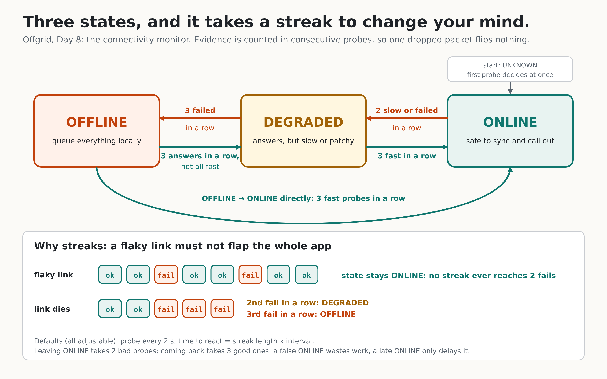

# Day 8: Connectivity monitor



Offgrid has to behave differently when the network is gone: queue the work locally instead of calling out. To do that it must know, at any moment, **is the network usable?** Today adds `internal/connectivity` and a live command, `offgrid net`.

## Three layers, so each can be tested alone

| Layer | What it is | Why separate |
|---|---|---|
| `Machine` (machine.go) | Pure state machine: verdicts in, transitions out. No clock, no goroutines, no network. | The tricky logic (hysteresis) is testable in microseconds with strings like `"gggfff"`. |
| `Prober` (probe.go) | One check of the network: HTTP, DNS, or several at once (`Any`). | Real network code is replaced by a fake in the Monitor tests, and tested alone against a local server. |
| `Monitor` (monitor.go) | The goroutine: probe on a timer, feed the Machine, publish events. | Concurrency concerns (shutdown, slow readers, races) live in one small place. |

## Concepts

**Probing is the only honest signal.** The operating system's "WiFi connected" light says nothing about whether data gets through. We make a small real request and look at the answer.

**HTTP 204, exactly.** The probe expects status 204 and refuses to follow redirects. Hotel and airport WiFi that you have not signed into answers 200 or 302 with a login page. A sloppy probe ("did I get any response?") would call that ONLINE, and the app would try to sync into a login page. Here it counts as a failure, and the error says "a captive portal login page?".

**`Any` of several targets.** One website being down is not "we are offline". `Any` probes all targets at once, returns the first success, and cancels the rest (no leaked goroutines).

**Three verdicts per probe:** good (answered fast), slow (answered, but slower than `SlowAfter`), fail. Slow is what makes DEGRADED possible: a link that technically works but takes seconds.

**Hysteresis = streaks.** The machine counts *consecutive* verdicts. One failure between successes resets the streak instead of changing the state, so a flaky link does not make the whole app flap between modes. Defaults: 3 fails in a row to OFFLINE, 2 slow-or-failed to DEGRADED, 3 good to come back. Leaving ONLINE is quicker than returning on purpose: a false ONLINE wastes work, a late ONLINE only delays it.

**Fast start.** State begins as UNKNOWN and the *first* probe decides at once. Waiting for a streak at startup would leave the program unsure for several intervals, right when it needs to know.

**Streaks describe probes, not states.** My first version reset the counters on every transition. A test caught the consequence: with 2 fails degrading and 3 fails going offline, OFFLINE took 2 + 3 = 5 failures instead of 3, because the first two "didn't count" any more. Streaks are facts about the last N probes, so they are not reset.

**Events never block the monitor.** `Events()` is a buffered channel of changes. If the reader is slow, the *oldest* event is dropped to make room for the newest (counted in `Dropped()`), because a late reader cares most about where things stand now. `State()` is always accurate and safe to call from any goroutine (an atomic), so code that only needs "online right now?" never has to read events at all.

**A cancelled probe is not evidence.** On shutdown, the in-flight probe returns an error. Counting it as a failure would flip the state to OFFLINE every time you quit. The monitor checks the context first and discards it.

**Clean shutdown.** Cancelling the context stops the monitor promptly, even in the middle of a probe or the wait between probes (both watch the context). `Events()` is closed when `Run` returns, so `for e := range mon.Events()` ends by itself.

## Go lessons

- **A goroutine's three duties:** it must stop (context), it must not leak (buffered result channels, cancelling losers), and it must not block on others (non-blocking publish).
- **`atomic.Int32` for a value read from many goroutines**, instead of a mutex when you only need one number.
- **Inject time.** `Config.Wait` lets tests run the monitor with no real sleeping. The scripted fake prober cancels the context when its script ends, so a test is deterministic and takes microseconds.
- **The race detector found a real bug in my CLI** (`offgrid net`): the monitor goroutine printed probe lines while the main goroutine printed transitions, both into one writer. It showed up as an intermittent failure; the fix is a mutex around output. Always run `make test-race`.
- **Property tests:** random verdict sequences, and for every transition we look back and check the streak that must have caused it.

## What is and is not proven

Tested: all transitions (table + 200 random seeds), the real HTTP prober against local servers (204, 200, 302 portal, 500, redirects, closed port, hung server, deadline), shutdown mid-probe and mid-wait, slow reader, concurrent `State()` reads under the race detector, and an end-to-end run where a real local server goes 503 and comes back. 17 deliberate code mutations were all caught by the tests.

Not tested here: toggling real WiFi (the sandbox has none). That is yours to do, see below. I also have not measured how long a real WiFi toggle takes to show; the arithmetic says: with the defaults a *refused/unreachable* network is detected in about `2 x 2 s` between probes plus the probes themselves (a few seconds); a network that silently swallows packets takes up to `3 x 1.5 s` timeouts plus waits, about 8.5 s. Measure yours.

## On your laptop

```bash
unzip -o ~/Downloads/offgrid-day8.zip       # over your Day 7 repo
make test && make build
./bin/offgrid net                            # watch live, Ctrl-C to stop
```

Now turn WiFi off and on from the top-right menu and watch the lines. Record this for the post. Useful variants:

```bash
./bin/offgrid net -once                      # one probe: exit code 0 or 1
./bin/offgrid net -interval 1s -down 2       # faster, twitchier
./bin/offgrid net -dns example.com           # also try a DNS lookup
./bin/offgrid net -for 60s | tee net.log     # a 60-second capture
```

Privacy note: the default targets (Cloudflare and Google connectivity-check URLs) tell those companies this machine is online. Use `-url` with your own server to avoid that; Day 19's sync server is the natural target.

If the network is up but a corporate proxy blocks those URLs, the monitor will say OFFLINE even though you can browse. Use `-url` with a reachable 204 endpoint.

## Post template (use your own capture)

> Day 8 of building Offgrid: your app should know when the internet is gone.
> A goroutine probes every 2 s and a state machine with hysteresis decides ONLINE / DEGRADED / OFFLINE. One dropped packet flips nothing; it takes a streak.
> The detail that bit me: my first version reset its counters on every transition, so going offline needed 5 failures instead of 3. A test caught it.
> Captive-portal WiFi answers 200 with a login page, so the probe demands exactly 204.
> [diagram: docs/day-08-states.png] [clip: toggling WiFi]
> Measured on my laptop: WiFi off -> OFFLINE in [your seconds].

Hook for distributed-systems engineers: failure detection with hysteresis is the same idea as the phi-accrual detector in Cassandra, in its simplest form.

## Self-check questions

1. Why must the probe accept only 204, and not "any response"? *Captive portals answer 200/302, which would look online.*
2. Why does a single failure between successes not change the state? *Streaks of consecutive verdicts; one odd probe resets the streak.*
3. What happens if nobody reads `Events()`? *The monitor never blocks; the oldest events are dropped, `State()` stays right.*
4. Why is a cancelled probe discarded? *It would count as a failure on every shutdown.*
5. Why `Any` with several targets? *One site down must not mean the machine is offline.*
6. With DegradeAfter=2 and DownAfter=3, how many failures to reach OFFLINE from ONLINE? *3: streaks keep counting through the transition.*

## What Day 9 builds on this

Day 9 is the durable job queue: work the model cannot do offline is stored as jobs that survive crashes. The monitor's `State()` and `Events()` tell the queue worker when to start draining (ONLINE) and when to pause (OFFLINE).
