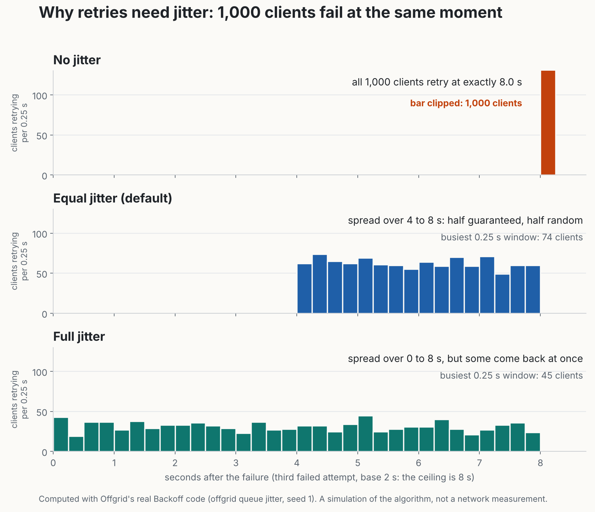

# Day 9: Durable job queue



When the network is down, or the model is too slow, the right move is not to fail: it is to **write the work down and do it later**. Today's `internal/jobqueue` is that notebook. A job survives restarts and crashes, retries with sensible waits, and gives up in a way a person can inspect.

## The lifecycle

```
queued ──claim──▶ running ──complete──▶ done
   ▲                 │
   └──retry later────┤ fail, attempts left
                     └ fail, none left (or permanent) ──▶ dead   (the dead-letter state)
```

`dead` is not deletion. The job stays, with its last error, so you can look at it and `retry` it by hand once the cause is fixed.

## Concepts

**Durability.** `Enqueue` is one SQLite transaction with durable commits (WAL + `synchronous=FULL`, set in `sqlstore.OpenDB`). When it returns, the job is on disk. I checked this the hard way: a loop of separate `offgrid queue enqueue` processes was killed with `kill -9` mid-run. Every acknowledged job was in the queue, `PRAGMA integrity_check` said `ok`. (One job was in the queue that had *not* been acknowledged: it committed, then the process died before reporting. That is exactly why idempotency keys exist.)

**Idempotency keys.** Every job has a key chosen by the caller, e.g. a hash of the message plus its day. Enqueueing the same key twice returns the *same job* and adds nothing (`created=false`). Without this, the classic failure: the program enqueues, crashes before it hears "ok", restarts, enqueues again, and the work happens twice. The same key with *different* content is an error (`ErrKeyConflict`): silently returning the old job would hide a bug in whoever picked the key. The key stays reserved even after the job is done.

**Backoff.** After each failure the wait doubles: 2 s, 4 s, 8 s, ... capped at 5 minutes. Time to recover is the point: a model that timed out or a network that dropped usually needs a moment.

**Jitter.** Pure doubling has a hidden flaw. If 1,000 clients fail at the same moment (a server blips, WiFi returns), they all wait exactly the same time and all retry at the same instant, again and again. The failure that caused the retries gets recreated by the retries. Adding randomness spreads them out. Three modes, all in `Backoff`:

| Mode | Delay | Trade-off |
|---|---|---|
| none | the ceiling, exactly | predictable, and creates the stampede |
| **equal** (default) | half the ceiling + random half | spreads, and always pauses at least half |
| full | random from 0 to the ceiling | spreads best, but a retry can come back at once |

The chart above is computed by the real code: `offgrid queue jitter` prints the delay each of 1,000 clients would pick. With no jitter all 1,000 retry in one instant. With equal jitter the busiest quarter-second holds 74; with full jitter, 45. It is a simulation of the algorithm, not a network measurement. On one laptop with one worker the stampede is not your problem today, but this is the habit that matters the day many devices sync to one server.

**Leases.** `Claim` does not just mark a job "running": it leases it for a time (default 1 minute). If the worker crashes or hangs, the lease expires and the job becomes claimable again. Without leases a crash strands the job in "running" forever. Long jobs (a model summarizing on CPU) call `Extend` to renew.

**Fencing tokens.** Suppose worker A's lease expires while it is still slowly working, and worker B claims the job. A then finishes and reports "done" for a claim that is no longer its own. Each claim bumps `attempts`, and that number is the token: `Complete`, `Fail` and `Extend` take it and the update only applies `WHERE attempts = token`. A's stale report gets `ErrStaleClaim`. This pattern appears in every serious lock service.

**A lost worker on the last attempt.** If the final allowed attempt is claimed and the worker vanishes, the next `Claim` moves the job to `dead` with a message, rather than handing it out forever.

**One atomic claim.** `UPDATE ... WHERE id = (SELECT ... LIMIT 1) RETURNING ...` picks and marks the job in one statement inside one transaction, so two workers can never receive the same job (tested with 8 goroutines and 200 jobs under the race detector).

**Clean layering.** The queue keeps its own file (`queue.db`), separate from the task log: jobs are local operational state, not shared facts, so they do not belong in the op log that sync will replicate. The queue takes a plain `*sql.DB` and never names the SQLite driver; an architecture test enforces that. Its schema version lives in SQLite's built-in `PRAGMA user_version`, changed inside the same transaction as the migration, so a crash cannot leave them disagreeing.

## Go lessons

- **Inject the clock and the randomness** (`Config.Now`, `Config.Rand`) and backoff becomes exactly testable: "attempt 3 waits 40 s" is a plain assertion.
- **`Delay(attempt, r)` takes the random number as an argument.** A pure function is easy to test; the queue supplies a real random number.
- **Overflow is a real bug class.** `Base << attempt` overflows for large attempts and produces negative or tiny waits. `Ceiling` stops doubling at the cap, and a test tries attempt 1000.
- **Constraints in the database as a last defence:** `CHECK (status IN (...))`, `json_valid(payload)`, `max_attempts >= 1`. A test confirms the database itself refuses bad rows.
- **`ON CONFLICT DO NOTHING` plus a read in one transaction** gives race-free "create or return the existing one" (16 goroutines enqueue the same key: exactly one creates it).

## What is proven

Tested: all backoff maths (bounds, cap, overflow, the stampede property), enqueue/claim/complete/fail/retry, ordering, the not-before time, idempotency and conflicts, dead-lettering, lease expiry, fencing, extend, the final-attempt case, 100 jobs surviving a restart (Go test and through the CLI), 8 concurrent workers, schema versioning and a failed migration rolling back. 19 deliberate code mutations were all caught by the tests (one survived at first, which exposed a missing test; I added it).

Not done today: nothing *consumes* the queue yet. Day 10 decides what gets queued; Day 12 drains it on reconnect and survives crashes mid-job. Today you drive the queue by hand with `offgrid queue`.

## On your laptop

```bash
unzip -o ~/Downloads/offgrid-day9.zip       # over your Day 8 repo
make test && make build
export OFFGRID_QUEUE=~/offgrid-data/queue.db
```

The "100 jobs offline" check (turn WiFi off first if you like; nothing here uses the network):

```bash
for i in $(seq 1 100); do
  ./bin/offgrid queue enqueue -key "offline-$i" -kind summarize "{\"week\":41,\"n\":$i}" >/dev/null
done
./bin/offgrid queue stats          # queued 100
./bin/offgrid queue enqueue -key offline-7 -kind summarize '{"week":41,"n":7}'   # already queued: nothing added
```

Walk one job through its life:

```bash
./bin/offgrid queue claim                       # prints {"id":1,"attempt":1,...}
./bin/offgrid queue fail -error "model timed out" 1 1     # will retry in ~1-2 s
./bin/offgrid queue list -n 3                   # queued again, TRIES 1/5, with the error
sleep 3; ./bin/offgrid queue claim              # attempt 2
./bin/offgrid queue fail -permanent -error "payload invalid" 1 2   # dead-letter
./bin/offgrid queue list -status dead
./bin/offgrid queue retry 1                     # you decide: try again from scratch
```

Kill test (what I ran): start a loop of enqueues, `kill -9` it, run `stats`: every job that printed "queued" is there.

The chart data: `./bin/offgrid queue jitter -clients 1000 -attempt 3 > jitter.csv`

## Post: "Why retries need jitter"

> Day 9 of building Offgrid. A durable job queue on SQLite: 100 jobs enqueued with the network off, all still there after a restart.
> The detail worth a post: retries need jitter. If 1,000 clients fail together and all wait "2, 4, 8 seconds", they ALL come back at the same instant, and the retries recreate the outage. Add randomness and the same 1,000 spread across the window. [chart]
> Also: idempotency keys (enqueue twice, run once), leases (a crashed worker can't strand a job), fencing tokens (a slow worker can't overwrite its replacement).
> I killed it with kill -9 mid-write. Every acknowledged job survived.
> The chart is computed by the real backoff code.

Hook for CTOs: "the classic failure modes" are the content: retry storms, duplicate work, stuck jobs, zombie workers.

## Self-check questions

1. Why does a retry delay need randomness? *Clients that fail together would retry together; jitter spreads the load.*
2. Why does equal jitter keep half the delay fixed? *To guarantee a minimum pause; full jitter can retry almost immediately.*
3. What does an idempotency key protect against? *Doing the work twice when a request is repeated, e.g. after a crash before the acknowledgement.*
4. Why is the same key with different content an error? *It means the caller's key choice is wrong; hiding that would hide a bug.*
5. What problem do leases solve? *A crashed worker leaving a job stuck in "running".*
6. What is the fencing token and what does it prevent? *The attempt number; it stops a worker whose lease expired from overwriting the new claim.*
7. Why is the queue in its own file, not the op log? *Jobs are local operational state; the op log holds facts that sync will replicate.*

## What Day 10 builds on this

Day 10 is the router and Checkpoint 1: it decides "answer now" (rules, the local model) or "defer" (enqueue a job here), using intent complexity, validity and the connectivity state from Day 8. With WiFi off, simple requests answer instantly and hard ones queue with a visible status.
