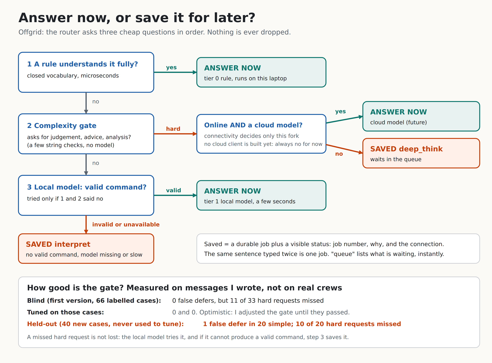

# Day 10: Router and Checkpoint 1



**Checkpoint 1: an offline agent plus a queue works end to end with WiFi off.** Today's `internal/router` joins everything from Days 3 to 9: the rules and model (Days 3 to 5), the connectivity state (Day 8) and the durable queue (Day 9). Every message now gets one of two fates: *answered now*, or *saved for later with a visible status*. Nothing is dropped.

## The router in one paragraph

For each message the router asks three cheap questions in order. (1) Does a Tier 0 rule fully understand it? Then answer instantly. (2) Does the **complexity gate** say it asks for judgement, advice or analysis, which no tool and no small model can give? Then it is "hard": answer it with a cloud model only if one exists and the network is up, otherwise save it as a `deep_think` job. (3) Otherwise try the local model; if it cannot produce a **valid** command (or is missing, down or too slow), save it as an `interpret` job instead of failing.

## Concepts

**Defer, never drop.** The old behaviour for a message nobody could handle was a polite error. A field worker's request is information; losing it is worse than answering late. Every path that cannot answer now ends in the durable queue, with a job number and a reason shown on screen. If even the queue refuses (disk full) the message says so, it never pretends.

**Rules come before the gate.** "new task: suggest a new filter supplier" contains a judgement word, but a rule fully understands the sentence, so it creates a task. Putting the gate first would have queued it. This is Day 5's rule again: when a precise, narrow mechanism understands the message, trust it; use the fuzzy mechanism (the gate) only on what is left.

**Three signals, three different jobs.**
- *Complexity* (the gate) decides **before** spending seconds on a model.
- *Output validity* decides **after** the model: no valid command means the message waits.
- *Connectivity* decides only one fork: hard requests are answered by a cloud model **only if one exists and the state is ONLINE**. Offline, degraded or unknown (never claim a connection you have not seen) means wait. No cloud client exists yet, so today this fork is always "wait"; the hook is tested with a fake so the rule is proven before the real thing is written. Connectivity also changes the wording of the status message ("you are offline, it will run when the connection is back").

**The gate is a scoring function, not a model.** Closed vocabularies, scored: a *strong* word (recommend, analyze, "what should", why, ...) is 3 points and enough alone; a *weak* word (suggest, explain, draft, plan) is 2 and needs a hint; hints are 1 point each: a time span, the whole list ("the open tasks"), a second request joined by "and", a long message. Three points means hard. It runs in microseconds and cannot fail. Precision first, as in Day 5: a wrongly queued simple request makes someone wait; a missed hard one is rescued by step 3.

**Idempotency again.** The job key is a hash of the exact text plus today's date. The same sentence twice today is one job ("Already saved as job #2. Not added again."); tomorrow it is a new request. The key is built from the exact text because the stored payload must match whenever the key matches, otherwise the queue would raise a key conflict. (A different capitalisation is just another job.)

**"Queue" is a question the router answers itself.** Typing `queue` or `what's queued` lists what is waiting, from the queue, instantly. The phrases are a closed list that deliberately leaves out "pending" and "waiting": the task rules already read those as questions about *tasks*, and the router must not steal them (there is a test).

## How good is the gate? (the honest part)

I wrote 66 labelled messages (33 simple, 33 hard) before tuning, and measured the first version blind:

| Set | False defers (simple wrongly queued) | Missed hard |
|---|---|---|
| Blind, first version (66 cases) | 0 of 33 | **11 of 33** |
| Tuned on those same cases | 0 | 0 (optimistic: I adjusted the gate until they passed) |
| **Held-out: 40 new cases written after tuning, never used to tune** | **1 of 20** ("add a task to explain the new procedure to Sam") | **10 of 20** |

So the real recall on unseen hard requests is about 50% on my own phrasing, and precision is high (1 false defer in 20). Passing the cases I tuned on proved little, which is exactly why the held-out set exists. All cases were written by one person (me), not collected from real crews, so treat this as a rough guide. You can reproduce the report with `./bin/offgrid agent -route-eval`.

The held-out misses are not lost. A missed hard request goes to the local model; if it cannot produce a valid command it is deferred by step 3. The remaining risk is a hard request the small model confidently turns into a wrong but *valid* command (for example "what is going wrong with the north pump" read as "list tasks"). Reads are harmless; writes are protected by Day 4's validation. A better gate would need real crew messages. That is a good thing to collect from your own use.

## What I checked

- The Day 10 goal through the command line: offline, no model, the simple requests answer in under a millisecond and the hard one is saved with a status.
- A real probe, not only forced state: with `-net auto` against a local server that is up, the router says "online"; with the server shut, it says "offline". Both pass in tests.
- 23 deliberate code mutations of the router and gate; all caught (two survived at first and exposed missing tests, which I added).
- Real WiFi toggling and a real Ollama were **not** tested here (the sandbox has neither). The demo script is built so you can do both.

Two small changes to Day 9 code, found while building this: `Enqueue` now looks before inserting, because SQLite's `ON CONFLICT DO NOTHING` still burns a job number (you would see job #2 then #4); and `offgrid queue list` now shows the payload instead of the hash key.

## On your laptop

```bash
unzip -o ~/Downloads/offgrid-day10.zip       # over your Day 9 repo
make test && make build
./bin/offgrid agent -route-eval              # the gate's honest numbers
```

**Checkpoint 1 test, with real WiFi.** `-net auto` probes the real network:

```bash
export OFFGRID_DB=~/offgrid-data/tasks.db OFFGRID_QUEUE=~/offgrid-data/queue.db
./bin/offgrid agent -seed -route -no-model "list open tasks"    # WiFi on:  routing on. connectivity: probing the network
# now turn WiFi OFF from the menu, wait about 5 seconds, then:
./bin/offgrid agent -route -no-model "summarize this week's incidents and suggest priorities"
./bin/offgrid agent -route -no-model "queue"
./bin/offgrid queue list
```

In `-net auto` the agent waits for its first probe (up to 4 s) so it knows the state; with the defaults it needs a few probes to flip from ONLINE to OFFLINE, so give it ~5 s after toggling (`./bin/offgrid net` shows it live in another terminal). For a retake that never depends on WiFi, use `-net offline`.

With Ollama installed, drop `-no-model` and simple messages the rules cannot read go to the local model (a few seconds); nothing else changes. I could not test this path against a real model.

## The flagship video (60 to 90 seconds)

`scripts/checkpoint1-demo.sh` is the script. Record with `PAUSE=2`:

```bash
make build
NET=auto scripts/checkpoint1-demo.sh 2       # turn WiFi off on camera right before it starts
NET=offline scripts/checkpoint1-demo.sh 2    # a retake that is identical every time
```

Suggested shots: (1) the WiFi icon crossed out, `offgrid net` saying OFFLINE; (2) three simple tasks answered in microseconds; (3) "summarize this week's incidents and suggest priorities" saved as job #1 with the plain-English status; (4) the same question again: "Not added again"; (5) `queue list`; (6) a simple request still instant. End card: "Day 12: it drains when the connection returns."

## Post template (use your own capture and numbers)

> Day 10 of building Offgrid: WiFi off, and the agent keeps working.
> Simple requests are answered on the laptop in microseconds. A hard one ("summarize this week's incidents and suggest priorities") isn't guessed at: it's saved in a durable queue with a visible status, and it won't be queued twice.
> The router asks three cheap questions: does a rule understand it? does it ask for judgement? did the local model produce something valid?
> The honest number: my "is this hard?" check caught 50% of unseen hard requests, with 1 false alarm in 20. The first version missed 11 of 33; tuning made my own test set look perfect and the held-out set showed the truth.
> [video] [diagram: docs/day-10-router.png]

Hook for everyone: this is the clip to send directly to people. Lead with the video, then the 50% number as the "I measure my own claims" line.

## Self-check questions

1. Why do rules run before the complexity gate? *A rule fully understands the sentence ("new task: suggest a supplier"), so it is simple whatever words the title contains; the gate is only for what remains.*
2. What are the three signals and what does each decide? *Complexity: skip the model for hard requests. Output validity: no valid command means defer. Connectivity: whether a cloud model may answer now; otherwise wait (and the wording of the status).*
3. Why does a held-out set exist? *Tuning on the test cases makes them pass without proving the gate generalises; unseen cases give the honest estimate.*
4. What happens to a request the gate misses? *The local model tries it; if the output is invalid, or the model is down or slow, it is deferred anyway.*
5. Why does the job key include today's date? *The same sentence today is the same request (no duplicate); tomorrow it is a new one.*
6. Why is "pending" not a queue word? *The task rules read it as a question about tasks; stealing it would break them.*
7. Why is Unknown connectivity treated as not online? *Never claim a connection you have not seen.*

## What Day 11 builds on this

Day 11 builds a switch to break your own network on purpose: a fault-injecting HTTP transport with latency, drop percentage and partition on/off, so failures are reproducible instead of depending on real WiFi. It will drive the connectivity monitor and the router deterministically, which is what makes the demos and the sync tests (Days 19 and 20) safe.
