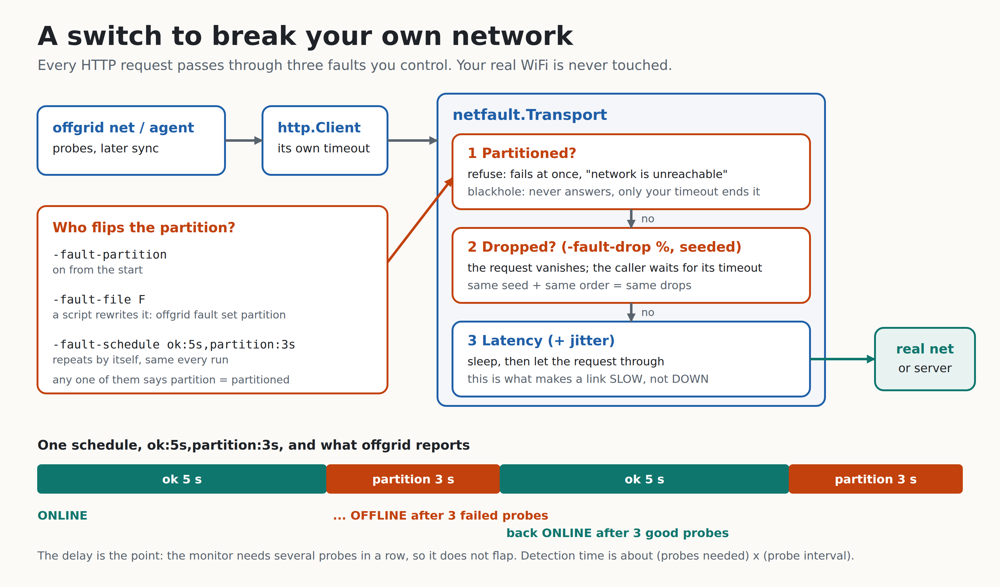

# Day 11: A switch to break your own network



You cannot test "what happens when the WiFi dies" by waiting for the WiFi to die. It dies at random, in different ways, and never while you are recording. Today's `internal/netfault` is a switch that breaks the network **on purpose and the same way every time**. It is also what makes the demos safe: a retake behaves exactly like the first take.

**Done when:** a script flips a partition on and off on a timer. `scripts/partition-demo.sh` does that, and it exits with an error if offgrid does not notice both flips, so it is a check as well as a show.

## The idea in one paragraph

Every HTTP client in Go sends its requests through an `http.RoundTripper`. `netfault.Transport` is a RoundTripper that wraps the real one. For each request it asks: is the network partitioned? is this request dropped? how much latency to add? Only then does it hand the request on. Because the wrapper sits *under* the client, the code above it (the connectivity probes today, the sync client on Day 19) does not know and does not change. No mocks of the code you want to test: you break the road, not the car.

## The three faults, and what each one really looks like

| Fault | Models | What the caller sees |
|---|---|---|
| **partition, refuse** (default) | WiFi switched off, cable pulled | An error at once: "network is unreachable" |
| **partition, blackhole** | Local link fine, the router upstream is dead | Nothing, until the caller's own timeout fires |
| **drop** (`-fault-drop 30`) | Packet loss | A random 30% of requests vanish; the caller waits for its timeout |
| **latency** (`-fault-latency 900ms -fault-jitter 200ms`) | A slow link | Every request that gets through is late |

Why two kinds of partition? They break different code. "Refuse" is easy: every error path gets exercised quickly. "Blackhole" is the one that finds real bugs: any code that calls the network **without a timeout** hangs forever, and a hang is far worse than an error. The Ollama client from Day 2 deliberately has no overall timeout (long answers stream for a while), which is exactly why it must always be given a `context` deadline. Blackhole mode is how you would find a place where someone forgot.

Latency and partition are different on purpose. Slow is not down. A probe that answers in 900 ms is slow, and the Day 8 monitor turns that into DEGRADED, not OFFLINE. There is a test for exactly that.

## Concepts

**Reproducibility is the whole feature.** Random faults you cannot repeat are useless: you see a bug once and never again. So the randomness is seeded (`-fault-seed`, default 1). The same seed and the same request order give the same drops.

**One roll per knob, always drawn.** Each request draws two random numbers, one for drop and one for jitter, *every time*, whether or not that fault is switched on. Why? If drawing the drop roll depended on the jitter setting, then changing the latency would shuffle which requests get dropped, and two runs would stop being comparable. A test (`TestChangingLatencyDoesNotChangeWhichRequestsDrop`) holds this.

**The caller's context ends a held request, not us.** A dropped request waits for the caller's `context` deadline and returns `context.DeadlineExceeded`, exactly how a real stalled connection ends. `-fault-hang` (default 30 s) is only a safety net for callers with no deadline, so a demo never freezes.

**Injected errors say so.** Every error carries "(injected: ...)" and wraps `ErrPartitioned` or `ErrDropped`, so `errors.Is` can tell fake faults from real ones, and nobody spends an hour blaming their router for a switch they flipped. Errors also implement `net.Error`, so code that asks "was that a timeout?" gets a sensible answer.

**Where does the switch live?** A running process has to be flipped from outside, so there are three sources of "partitioned now", and any one saying yes means partitioned:
- `-fault-partition`: on from the start.
- `-fault-file F`: a one-word file, `partition` or `ok`. A script rewrites it; the process reads it on every request (a few bytes from the page cache). `offgrid fault set partition` writes it for you.
- `-fault-schedule ok:5s,partition:3s`: a repeating timetable. It is a pure function of elapsed time, so it is tested without waiting.

**A typo must not silently leave the network up.** If the control file contains anything but `partition` or `ok` (even an empty file), the request fails loudly with the file name. A missing file means ok.

**Atomic writes.** `offgrid fault set` writes a temporary file and renames it. A plain write is "truncate, then write", and a reader that lands in the gap sees an empty file. A test hammers the file with 1000 flips while another goroutine reads it nonstop and requires zero torn reads. Replacing the rename with a plain write makes it fail.

**An environment variable must not switch injection on by itself.** `$OFFGRID_FAULT` is only the *default value* for `-fault-file`. If it alone turned faults on, a leftover `export` from yesterday would make today's real probes fail and you would not know why. Injection starts only when you pass some `-fault-*` flag, and every run with it on prints `FAULT INJECTION ON (simulated, not your real network)` first and a count of what was injected at the end.

## What I checked

- `go test -race ./...` is green. The new package has 32 tests, and the command line adds 20 more.
- Mutation testing: I broke the code on purpose 32 ways (ignore the partition, off-by-one in the schedule boundary, write the file non-atomically, always-skip the body close, ignore the seed, follow redirects, and so on). All were caught except two that are *equivalent mutants*: a random float landing exactly on the drop percentage (probability about 0), and a clamp for negative elapsed time that the loop already handles. Four survivors in the command-line layer showed real gaps (the seed flag, the mode flag, redirects not being followed, and the environment control file being ignored when it should apply); I added tests or fixed the code, and all four are now caught.
- The drop rate is measured: 5%, 30% and 70% over 20,000 requests each land within 2 points.
- Sandbox run of the demo (a slow shared machine; your timings will differ):

```
08:26:47  ==> UNKNOWN -> ONLINE  (first probe answered quickly)
08:26:50  ==> ONLINE -> DEGRADED  (2 slow or failed probes in a row)
08:26:51  ==> DEGRADED -> OFFLINE  (3 probes failed in a row)
08:26:54  ==> OFFLINE -> ONLINE  (3 fast probes in a row)
fault injection: 40 requests: 30 passed, 10 refused or swallowed by the partition, 0 dropped
```

The partition began at 08:26:50 and OFFLINE was reported at 08:26:51 with 300 ms probes: about three probes. With the defaults (2 s probes, 3 failures) detection takes about 6 s. That delay is the hysteresis from Day 8 doing its job.

## Honest limits

- This breaks **HTTP requests made through the transport**. It does not touch the operating system's network, DNS lookups made outside the HTTP client (`-dns` probes use the resolver directly), or Ollama (a local server on 127.0.0.1, which is the point: the model keeps working). To disturb those you need OS tools such as `tc netem`, which I did not use.
- Faults apply per request, not per packet. "30% drop" means 30% of requests, not 30% of TCP packets; real packet loss shows up as slowness before it shows up as failure.
- Not tested: a real WiFi toggle, a real captive portal, or any real Ollama run.

## On your laptop

```bash
cd ~/offgrid                               # your Day 10 repo
unzip -o ~/Downloads/offgrid-day11.zip
make test && make build
make partition-demo                        # or: scripts/partition-demo.sh 4 4
```

Try the switch by hand, in two terminals:

```bash
# terminal 1: a local "internet"
./bin/offgrid fault serve                  # prints http://127.0.0.1:PORT/generate_204

# terminal 2: watch it, with a control file
export OFFGRID_FAULT=/tmp/fault
./bin/offgrid net -url http://127.0.0.1:PORT/generate_204 -interval 300ms -fault-file $OFFGRID_FAULT

# terminal 3: break and heal it
./bin/offgrid fault set partition
./bin/offgrid fault set ok
```

Slow, not dead: `offgrid net -url ... -fault-latency 900ms -slow 500ms -timeout 2s` goes to DEGRADED, never OFFLINE. The nasty one: add `-fault-partition -fault-mode blackhole` and each probe only fails when its own timeout fires.

The router under a simulated partition (hard request waits, with the offline wording):

```bash
./bin/offgrid agent -no-model -route -net auto -url http://127.0.0.1:PORT/generate_204 \
  -fault-partition "summarize this week's incidents and suggest priorities"
```

## Post template (use your own capture)

> Day 11 of building Offgrid: I built a switch to break my own network on purpose.
> A fault-injecting HTTP transport: latency, packet loss, partitions, all seeded so a failure repeats exactly. A script flips the partition every few seconds and the agent goes ONLINE, OFFLINE, ONLINE on cue.
> Two kinds of "down": refused at once (WiFi off) and blackholed (nothing ever answers). The second one finds every missing timeout.
> Bonus: my demos can no longer be ruined by hotel WiFi.
> [clip: `make partition-demo`, or docs/day-11-fault.png]

Record the demo with `scripts/partition-demo.sh 5 5`. Only say you tested real WiFi if you did.

## Self-check questions

1. Why put the faults in a RoundTripper instead of mocking the probe? *The code under test stays unchanged; every client built on http.Client gets the faults for free.*
2. What is the difference between refuse and blackhole, and which finds a missing timeout? *Refuse fails at once; blackhole never answers, so only blackhole hangs code that has no timeout.*
3. Why does every request draw both random numbers even when a fault is off? *So turning one knob does not change which requests the other drops; runs stay comparable.*
4. Why rename a temp file instead of writing the control file in place? *A reader could see the empty file between truncate and write; rename is atomic.*
5. Why must `$OFFGRID_FAULT` alone not enable injection? *A stale export would silently break real runs.*
6. Why is high latency DEGRADED, not OFFLINE? *Slow still works; treating it as down would stop work that could proceed.*

## What Day 12 builds on this

Day 12 adds the worker that drains the queue when the connection returns, with a concurrency limit and resumable progress. It needs to be tested *while the network flaps*, and now there is a switch for that: the demo script can partition the network in the middle of a drain, and the `kill -9` test from the roadmap can run on top.
