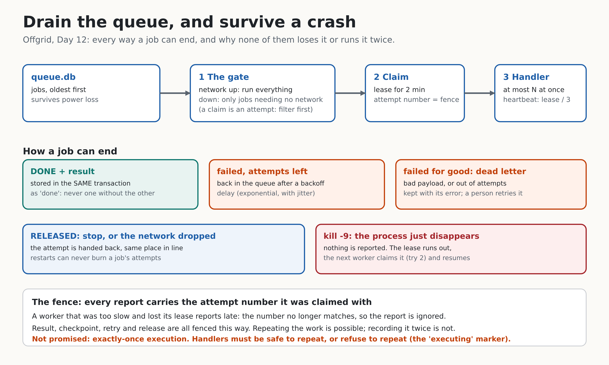

# Day 12: Drain on reconnect, survive a crash



Days 9 and 10 put hard requests into a durable queue. Today they come out again. `offgrid drain` is a worker that empties the queue **when it can**: in order, a few at a time, only the jobs the current network allows, and without losing or repeating a job even if the process is killed with `kill -9` in the middle.

**Done when:** an automated test runs `kill -9` mid-drain, restarts, and finds no lost jobs and no duplicates. That is `TestKill9MidDrainLosesNothingAndDuplicatesNothing` in `internal/drain`, and `scripts/drain-demo.sh` does the same thing on the real binary.

## The idea in one paragraph

A worker loop claims the next ready job, runs a handler, and reports one of five endings: done (with a result), failed with attempts left, failed for good, released, or *nothing at all* because the process died. Each ending is designed so the queue stays correct: results are stored in the same transaction as "done", every report is **fenced** with the attempt number it was claimed under, and a job whose worker disappeared simply becomes claimable again when its lease runs out.

## Concepts

**At-least-once, not exactly-once.** After a crash a job can run again. No design removes that: the worker cannot know whether the process died before or after the work. What you *can* guarantee is that the **recorded outcome** happens once. So the contract is: delivery is at-least-once, recording is exactly-once (fenced), and handlers are either safe to repeat or refuse to repeat. Anyone who promises "exactly-once execution" without saying how is selling something.

**The fence.** Claiming a job increments its `attempts`, and that number is the job's fencing token. `Complete`, `Fail`, `Extend`, `Checkpoint` and `Release` only work when the token matches. A worker that was too slow, lost its lease and then reports late is rejected with `ErrStaleClaim`: it cannot overwrite the new owner's result, checkpoint, or status.

**Result and "done" in one transaction.** `CompleteWith` marks the job done and inserts its result in a single transaction. Doing them separately leaves a window where a crash keeps one without the other (a "done" job with no answer, or an answer for a job that will run again). A test checks that a rejected (stale) completion leaves no result row behind.

**The gate decides before claiming.** A claim counts as an attempt, so "claim it, notice we are offline, put it back" would burn attempts and eventually dead-letter good jobs. Instead `ClaimKinds` filters by kind **inside** the claim. Offline, the worker claims only kinds that need no network (`interpret`, which uses the model on this laptop). Online, it claims everything. Which kinds need the network is a property of the handler (`NeedsNetwork`), not a guess.

**Release is not failure.** When the worker is stopped, or the network drops while a network job is running, the job is *released*: it goes back to queued, its attempt is handed back, and it keeps its place in line. Reporting that as a failure would apply a backoff delay and use up an attempt, and enough restarts would dead-letter a perfectly good job. A test restarts a job with only 2 attempts six times and checks it is still queued with 0 attempts used.

**Heartbeat.** The lease is how a dead worker's jobs come back, so it must be short enough to recover quickly. But a legitimate job can take minutes on a CPU. So while the handler runs, the worker renews the lease every third of its length. If the renewal comes back `ErrStaleClaim`, someone took the job over: the handler's context is cancelled and the worker reports nothing.

**Checkpoints (resumable progress).** A handler can save how far it got (`Progress.Save`). If the job is claimed again, the text is in `Job.Progress`. The kill test's jobs have three steps; a restarted job resumes at its last checkpoint instead of starting over. It is fenced and survives retries.

**Concurrency limit, in order.** A semaphore of N slots; a job is claimed only after a slot is free, so the network decision is made as late as possible. Jobs *start* in queue order. With one slot they also finish in order (tested); with N they can finish out of order, which is the point of concurrency.

**A panic fails one job, not the worker.** The handler runs under `recover`. A job that panics is retried and eventually dead-lettered like any other failure while the others continue.

**Two ways to be safe after a crash.** `deep_think` jobs only *read* (they answer a question from the task list), so repeating one is harmless: *idempotent*. `interpret` jobs can *change tasks* ("add a task about the fuel line"), and repeating that makes two tasks: *at-most-once* is needed. The handler first lets the model read the message (the slow part), then saves the checkpoint `executing`, then runs the command. If the process dies in between and the job comes back, it sees the marker and **refuses to run again**: it dead-letters the job with a message telling a person to check the task list and, if the change is missing, `offgrid queue retry ID`. The cost is a human glance in a rare case; the benefit is that a duplicate task is impossible. A test kills the handler after the change and verifies exactly one task exists.

**What a deep_think answer is based on.** The handler gives the model the real task list (with the latest notes) and tells it to use only that data. Without it, "summarize this week's incidents" would be made up. By default the answer comes from your local model (no network needed); with `-deep-host http://bigger-machine:11434` the job goes to another Ollama server and **waits for the network**.

## Using it

```bash
# an offline session saves what it cannot answer (Day 10)
./bin/offgrid agent -route -net offline -db tasks.db "what should I prioritize this week?"

# later: drain. Leave it running; it waits for the network when needed
./bin/offgrid drain -db tasks.db                 # Ctrl-C stops it cleanly (jobs are given back)
./bin/offgrid drain -db tasks.db -once           # stop when nothing more can run now
./bin/offgrid queue result 1                     # read an answer
```

Useful flags: `-concurrency 2`, `-lease 2m`, `-deep-host URL` (a model on another machine: waits for the network), `-net auto|online|offline`, and the Day 11 `-fault-*` flags to cut the network under it. `-once` also waits for jobs that another (or a dead) worker holds until their lease ends, so a restart after a crash finishes what the crash left.

## What I checked

- `go test -race ./...` is green. New tests: 43 in `internal/drain` (plus the helper process the kill test starts), 18 for the queue additions, 8 for `drain` on the command line.
- **The kill test.** A child process (this test binary, started again) runs a real worker on a real SQLite file with 4 slots and a 400 ms lease. The parent waits until jobs are in flight and kills it with SIGKILL, three times at different moments (random extra delay per seed), then starts a final worker and checks the database: 60 jobs, **60 done, none queued/running/dead, exactly 60 results (one per job), exactly 180 step effects (3 per job), `PRAGMA integrity_check` ok**. It also requires that at least one job needed a second attempt, so a kill that lands on nothing cannot pass. Three seeds, repeated 6 times under the race detector (18 runs), all green.
- What the kills actually did (sandbox, varies run to run): 8 to 12 of the 60 jobs needed a second attempt, and 7 to 12 extra step executions happened. That is **repeated work, not duplicated outcomes**: each killed job redid at most the one step it was in, and the effect table (primary key) kept it to one. The test bounds the repeated work at 4 jobs in flight x 3 kills = 12.
- Mutation testing: 41 deliberate breakages. 39 were caught. The two that "survived" are equivalent: inserting the result before the fence check changes nothing because the failed transaction rolls it back (that is the atomicity working), and skipping the explicit lost-lease branch still ends in the same outcome because the fence rejects the report anyway. Broken on purpose and caught, among others: no heartbeat, a gate that ignores the network, release treated as failure, result stored separately from "done", unfenced release/checkpoint, a missing "executing" marker, concurrency off by one, and no panic recovery. One survivor in the first round (the re-check between claim and start) was a real test gap; I added a test for it.
- A real v1 queue file (made by Day 9) opens, keeps its jobs, and gains the new column and table (migration 2).
- `scripts/drain-demo.sh` on the real binary: 6 saved jobs, `kill -9` with 2 in flight, restart: all 6 done, 4 with 1/5 tries and 2 with 2/5.

## Honest limits

- **`kill -9` is not a power cut.** It kills the process; the operating system and the disk survive. Durability against power loss rests on SQLite's `synchronous=FULL` and WAL (set since Day 6), which I did not test by pulling a plug.
- The demo and the kill test use a **stand-in model server** (`offgrid fault model`) with canned answers, and the demo says so. It speaks Ollama's protocol (tested with the real client) but is not a language model. I have not run `drain` against a real Ollama; the handlers are tested with fakes of the same interface.
- `deep_think` answers are only as good as your local model and only know the task list.
- SQLite allows one writer. With many workers on one file they take turns; that is fine at this scale and would not be at a different one.
- `-once` can wait up to a lease (2 minutes by default) after a crash. Use `-lease 10s` for a quicker recovery in a hurry, at the price of more renewals.
- Jobs of a kind this worker does not run (a newer Offgrid's kind, say) stay queued, untouched, forever; `-once` says "N still queued" without explaining why.

## On your laptop

```bash
cd ~/offgrid                                # your Day 11 repo
unzip -o ~/Downloads/offgrid-day12.zip
make test && make build
make drain-demo                             # kill -9 a drain: nothing lost (uses the stand-in model)
STANDIN=0 scripts/drain-demo.sh             # the same, with your real Ollama running
```

For the flagship clip, record `make drain-demo PAUSE=2`. If you later record against real Ollama (`STANDIN=0`), say so in the post.

## Post template (use your own capture)

> Day 12 of building Offgrid: I killed my own program with kill -9 in the middle of its work. Then I restarted it. Nothing was lost and nothing ran twice.
> The queue worker drains jobs when the network returns. Every result is stored in the same transaction that marks the job done, every report carries an attempt number (a fence), and a stopped worker hands its attempt back instead of burning it.
> The honest part: after a crash a job can run again. So jobs that only read are safe to repeat, and jobs that change data refuse to repeat. A person checks the rare ambiguous one.
> [clip: `make drain-demo`, or docs/day-12-drain.png]

## Self-check questions

1. Why is exactly-once execution impossible after a crash, and what is guaranteed instead? *The worker cannot know whether it died before or after the work. At-least-once execution plus exactly-once recording (fenced result).*
2. What does the fencing token stop? *A worker that lost its lease reporting late and overwriting the new owner's result, checkpoint or status.*
3. Why filter by kind inside the claim instead of claiming and putting back? *A claim counts as an attempt; put-backs would burn attempts and could dead-letter good jobs.*
4. Why release instead of fail on shutdown? *Fail applies backoff and uses an attempt; repeated restarts would kill the job.*
5. Why store the result and "done" in one transaction? *A crash between two writes would leave one without the other.*
6. Why does `interpret` save an "executing" marker, and what does it cost? *It prevents a duplicate change after a crash. The cost is a person must check the one ambiguous job.*
7. Why is a heartbeat needed if there is a lease? *The lease must be short to recover quickly, but a legitimate job can run longer; renewing keeps it from being taken over.*

## What Day 13 builds on this

Day 13 makes the system visible: structured logs with `log/slog`, counters (queue depth, jobs per tier, latency) and a terminal view showing connection state, the queue and the router's decisions live. The worker already emits an `Event` for everything it does, and the router and connectivity monitor have their own, so most of the data exists; today's `printDrainEvent` is the plain-logs fallback Checkpoint 1 mentions.
