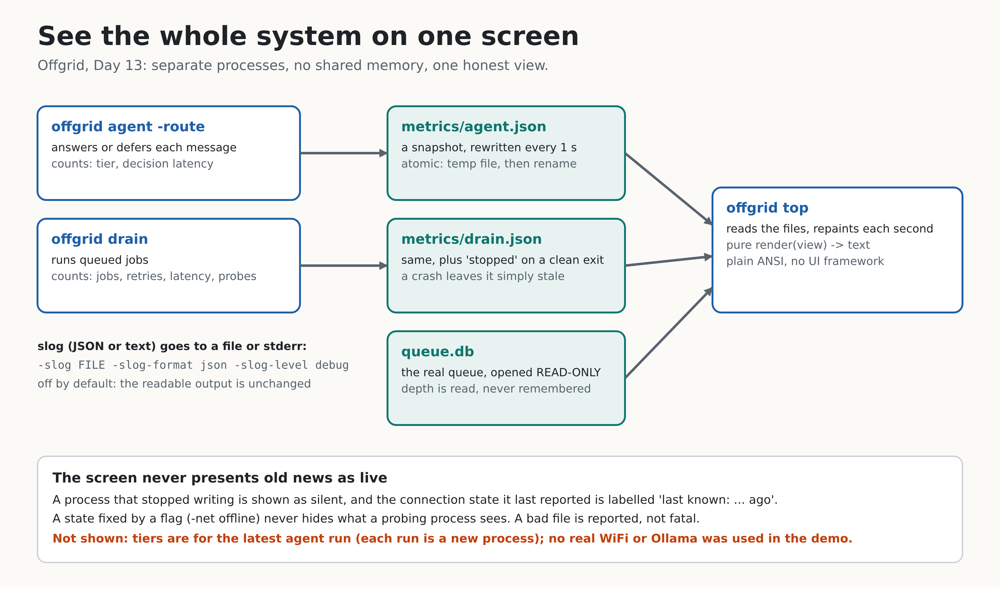

# Day 13: See the system



Twelve days of machinery, and until today the only way to know what it was doing was to read scrolling text. Today the system explains itself: **structured logs** (`log/slog`), **counters** (queue depth, jobs per kind, decisions per tier, latency percentiles), and **one screen** (`offgrid top`) that shows the connection state, the queue and the tier decisions together.

**Done when:** one screen shows the whole system's state. `scripts/top-demo.sh` runs a (simulated) outage while `offgrid top` is up, and in plain mode it checks that the screen told the truth about it.

## The idea in one paragraph

Offgrid is several processes over a pair of files: `agent -route` decides, `drain` works, and they share no memory. So the viewer cannot just read a variable. Each process keeps its own counters and **publishes a small JSON snapshot file once a second** (written to a temp file and renamed, so a reader never sees half a file). `offgrid top` reads those files, reads the queue itself (opened **read-only**), and repaints. Logs are a separate stream for people and tools that want a history rather than a picture.

## Concepts

**Logs and metrics answer different questions.** A log line says *what happened* ("job 7 failed, will retry in 4s: connection refused"). A counter says *how much and how often* ("3 retries this hour, p95 latency 3.4 s"). You need both: counters tell you something is wrong, logs tell you why. So `-slog` gives structured logs (key=value text, or JSON with `-slog-format json`) and the snapshot carries the counters.

**Structured, not formatted.** `slog.Info("job done", "job", 7, "kind", "interpret")` keeps `job=7` as a field a program can filter on. A formatted string ("job 7 interpret done") has to be parsed back with a regex, and every wording change breaks the parser. Levels carry meaning here: a retry is a warning, a dead job an error, a network probe a debug line (a probe every 2 seconds would drown everything else at `info`).

**Counters never forget; windows do.** A counter ("jobs done: 412") only goes up. Latency needs a window: percentiles over the last 256 jobs, not since boot, otherwise a slow hour last week would still colour today's p95. The windows are bounded, so memory does not grow however long the process runs. Percentiles use *nearest rank* (p95 of 100 values is the 95th smallest), which always returns a value that really happened; an average would hide the one slow job that matters.

**Gauges are read, not remembered.** Queue depth is a *gauge*: it goes up and down, and the only correct source is the queue. `top` reads it straight from `queue.db`, opened with `mode=ro` (SQLite itself refuses writes) and without running migrations, so a viewer can never change or upgrade the file a worker is using. A test checks the file's bytes are identical after looking.

**A view should be a pure function.** `dash.Render(view, options)` takes data and returns a string. No clock, no terminal, no files. That is why the screen has a **golden test** (the whole frame, compared character for character) and property tests (every line fits the width, boxes align, no escape codes without colour). The part that touches the terminal (`Live`) is a few lines that repaint and always restore the terminal, tested with a fake writer.

**Honesty about old data.** This is the part most dashboards get wrong. If `drain` is killed, its last snapshot says "ONLINE" forever. `top` therefore checks every snapshot's age against that process's own publish interval: a process that wrote within three intervals is *live*; one that said it stopped is *stopped*; one that went quiet without saying so is *silent* (that is how a crash looks). A connection state from a process that is not live is labelled `last known: drain went silent 30.0s ago` and never gets a "for 2 minutes" duration, because that wording claims it is still true. Also: a state fixed by a flag (`-net offline`, which is a pretend) never hides what a process that really probes the network sees.

**Why not Bubble Tea?** The roadmap names it, and it is a fine library. I tried it here: it could be built in this sandbox only by redirecting `golang.org/x/sys` to a GitHub mirror with `replace` lines in `go.mod`. That would put workarounds into your repository that you would have to remove again, and it would make a small static binary depend on a UI framework for something that is, at its core, "print a frame, move the cursor home, repeat". So the screen uses plain ANSI escapes and the standard library. Because the renderer is a pure function, swapping in Bubble Tea later means writing a `Model` whose `View()` calls `dash.Render`. Nothing else changes. This is a decision, not a claim that Bubble Tea is wrong.

## Using it

```bash
# terminal 1: the worker (simulated or real network)
./bin/offgrid drain -db tasks.db -slog drain.log -slog-level debug

# terminal 2: requests, and the screen
./bin/offgrid agent -route -db tasks.db "why does the fuel line keep cracking"
./bin/offgrid top -queue queue.db            # live; Ctrl-C quits
./bin/offgrid top -queue queue.db -once      # one frame, for a bug report
```

Flags: `-slog FILE|-` (a file is appended to, `-` is stderr), `-slog-format text|json`, `-slog-level debug|info|warn|error` on `drain` and `agent -route`; `-metrics DIR|off` to move or disable the snapshots (default: `metrics/` next to the queue file); `top` takes `-interval`, `-once`, `-color auto|always|never` (honours `NO_COLOR`) and `-width`. Structured logs are **off by default**, so the readable output you already know is unchanged. (`agent` already had `-log`, a one-JSON-line-per-message file; the new flags are `-slog*` so the two do not collide.)

```bash
make top-demo SECS=26       # in a terminal: the live screen, with a simulated outage. Record this.
```

## What I checked

- `go test -race ./...` is green. New tests: 33 in `internal/obs`, 22 in `internal/dash`, 20 for the commands (`top`, logs, snapshots) and 4 for the read-only queue.
- **The screen against reality.** A command-line test saves two requests offline, shows the screen (2 queued, offline, "last known" because the process has exited), drains, and shows it again (0 queued, 2 done, per-kind counts), and the snapshot numbers agree with the database.
- **A real defect found by running it**, not by a test: network events were counted as a job of an empty kind, which drew a blank row; and a stopped process's last state was shown as "for 2.4s", as if live. Both fixed, both now tested.
- Mutation testing: 58 deliberate breakages over `obs`, `dash` and the command wiring. Initially 8 survived, each a test gap: the sparkline showing the oldest instead of the newest values, an unwiped line end, no blank line between piped frames, `-metrics off` creating a folder named `off`, a viewer that could create a queue file, a log truncated instead of appended to, the minimum `-width`, and the `NO_COLOR` rule (which I pulled out into a small testable function, `useColor`). I closed each with a test and re-ran them; all are caught. Two (the minimum `-width` and `-interval`) are caught only by a timeout, because the broken code makes `top` run forever instead of failing an assertion: a real failure, but a blunt signal.
- `scripts/top-demo.sh` (plain mode) on the real binary: 9 of 9 checks pass (offline at the start, jobs waiting, interpret ran offline, outage and recovery in the history, nothing left, nothing dead).

## Honest limits

- **The network in the demo is simulated** (a local 204 server behind a scripted outage) and the model is a **stand-in** with canned answers. I have not run `top` against your real WiFi or a real Ollama.
- **No terminal emulator test.** I tested the exact bytes written to a terminal and the frames as text; I have not watched it in Zorin's terminal. If your terminal mangles the box characters or the alternate screen, tell me and I will add `-ascii`.
- **Tiers show the latest `agent -route` run only.** Each run is a new process with fresh counters (the panel says so). Cumulative history would need counters stored in a database, a reasonable Day 14+ addition. The worker's counters (`this worker`) reset the same way on each `drain` start.
- Counters are per process; two `drain` workers on one queue publish under the same name and overwrite each other's file (the queue depth, read from the database, is always right).
- Snapshots are written every second without `fsync`: after a power cut the last one may be missing, and it is simply stale. A snapshot directory on a slow disk is the reason to use `-metrics off`.
- There is no key handling (Ctrl-C only): reading single keypresses portably needs a terminal library, which is exactly the dependency I chose not to add.
- SQLite may create `-shm` and `-wal` sidecar files next to the queue when `top` reads it; the queue file's bytes do not change.

## On your laptop

```bash
cd ~/offgrid                                # your Day 12 repo
unzip -o ~/Downloads/offgrid-day13.zip      # README.md and Makefile are overwritten: see the note below
make test && make build
make top-demo                               # in a terminal; record this for the post
```

If you edited `README.md` or `Makefile` yourself, merge by hand instead: the changes are one status line, one table row, two lines in the layout list, and a `top-demo` target.

## Post template (use your own capture)

> Day 13 of building Offgrid: one screen shows the whole system.
> Connection state, the queue, which tier answered each message, latency percentiles, all live. In the clip the (simulated) network drops, the requests pile up, it comes back, and the queue drains.
> The part I care about: the screen never presents old news as live. If a process dies, its last reading is labelled "last known, 30 s ago" instead of staying green forever.
> No UI framework: a pure render function and plain ANSI. [clip: `make top-demo`]

## Self-check questions

1. Why does each process publish a snapshot file instead of the viewer reading memory? *They are separate processes; nothing is shared. A file written by rename is always whole.*
2. Why is queue depth read from the queue and not counted by the processes? *It is a gauge with one true source; counting events drifts after a crash or a second worker.*
3. Why percentiles over a window instead of an average over all time? *An average hides the slow job, and all-time numbers never recover from an old bad hour.*
4. How does `top` tell a stopped process from a crashed one? *A clean exit writes a final snapshot marked stopped; a crash just stops writing, so its age exceeds three intervals.*
5. Why does a stale connection state lose its "for 2 minutes" wording? *The duration claims it is still true, and nothing is checking.*
6. Why is `Render` a pure function? *It can be tested exactly (golden frame) and the terminal code around it stays tiny.*

## What Day 14 does with this

Day 14 is a light day: `ARCHITECTURE.md` v1 (this screen is a good way to explain the system: every box in it is a component), tag `v0.1`, the target list of 40 companies, and a week-2 recap post built around the `kill -9` clip.
