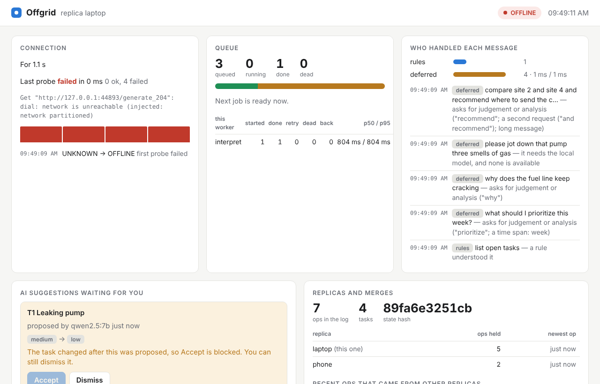

# Day 26: the dashboard, from the single binary (Checkpoint 3, feature freeze)

**Done when:** the dashboard runs from the single binary. It does: the page, its script and its style are inside `offgrid` (`go:embed`), so nothing is installed, nothing is downloaded, and it works with the WiFi off.

```bash
offgrid web -db ~/offgrid/tasks.db          # then open http://127.0.0.1:8787
make web-demo SECS=60                      # real demo data; prints the address
make web-check                             # the same demo with no browser; fails if the data is wrong
```



*From `make web-demo`: a laptop and a phone that really sync, the network cut by the simulated outage, a stand-in model. The tasks, ops, queue, suggestions and page are real; the outage and the model are not.*

## What it shows

| Panel | Where the data comes from |
|---|---|
| **Connection**: ONLINE / DEGRADED / OFFLINE, how long, last probe, recent probe times, recent flips | what `drain` and `agent -route` publish (the same files `offgrid top` reads) |
| **Queue**: queued, running, done, dead, next job ready in, per-kind counts and latency | the queue file, read-only |
| **Who handled each message**: rules, model, deferred, with latency, and the last decisions with their reasons | the same snapshots |
| **Replicas and merges**: every replica this log has ops from, how many, when the newest arrived, and the recent ops that **came from other replicas**, described in a line ("phone changed T1: priority medium") | the op log |
| **AI suggestions waiting for you**: what it would change (now → proposed), who proposed it, and **Accept** / **Dismiss** | the suggestions in the log |
| **Tasks**, **recent events** | the task view, the snapshots |

The terminal screen and the web page are two views of one merge (`dash.Summarize`), so they cannot disagree about the connection or the tiers.

**Never old news as live.** If the process that reported the connection stopped, the pill says `offline (last known)` and the panel says who went quiet and when. If the page cannot reach the server, it keeps the last data, dims it, and says "Cannot reach Offgrid. What you see is old: last updated 10:28:44." (I killed the server under a real browser to see this.)

## The one write

A person pressing Accept or Dismiss calls the store's own `Resolve`, the same code as `offgrid suggestions accept|dismiss`. The dashboard does not add a second way for an AI proposal to reach a task. A suggestion whose task a person has edited since is marked **stale**, its Accept button is disabled, and the server refuses it too (HTTP 409), so a stale tab cannot do what the screen would not let you do. Dismiss always works. `-read-only` removes both buttons and the server refuses the request.

## Safety: no login, so it never leaves this machine

The dashboard has no login and no encryption, so everything below exists to keep it from being reachable by anyone but you:

- **It refuses to listen on any address but 127.0.0.1, ::1 or localhost.** `-listen 0.0.0.0:8787` is an error, not a warning.
- **Host check.** A web page on another site can re-point its own name at 127.0.0.1 ("DNS rebinding") and then talk to local servers. Such a request arrives with another Host and is refused.
- **No change from a link or another site.** Only the POST route changes anything. It needs a custom header (a page on another site cannot send one without a CORS permission this server never gives), a same-origin `Origin` if the browser sends one, and a same-origin `Sec-Fetch-Site`. A GET never changes anything.
- **The page cannot run text from data.** Task titles and AI suggestions are text somebody else wrote. The script only ever sets `textContent` (a test fails if `innerHTML`, `eval` or the like appears), and the Content-Security-Policy is `default-src 'none'` plus its own script, style and server only: no inline script, no framing, no outside network. A task titled `` shows as that text.
- **Same one database.** I accepted a suggestion in the browser and then read the database from the command line, a separate process, and it was applied.

## What I tested

- `go test ./internal/web ./cmd/offgrid`, including a real process on a real socket (`TestTheDashboardRunsFromTheBinaryAndAcceptsASuggestion`), and the race detector on the web package with 12 tabs polling while 6 suggestions are resolved.
- **A real Chromium, driven by me**, against `make web-demo`: no console or CSP errors; Accept disabled on the stale suggestion; Dismiss and Accept worked and the toast, task row and suggestion list updated; dark mode; a 390 px phone width; the old-data banner.
- Mutation testing: bugs put into the guard, the state builder and the store additions, each of which a test must catch. 33 bugs: 32 caught. Four got past my first tests and are now closed (a malformed Origin header was accepted, the decision and event lists were not cut to their limit, replicas could be listed in any order). The one left, dropping `ORDER BY` from the replica query, cannot change what the page shows, because the page sorts them again; I count it as equivalent, not caught.

## What this does not show

- **Not on your laptop, and only Chromium.** Firefox and Safari were not run. No screen reader or keyboard-only pass beyond real buttons with focus outlines.
- **No history.** It shows what is true now: no graphs over time, no sync log. "Merges" are the recent ops that arrived from another replica, not a record of sync sessions (the log does not store those).
- **Polling every 2 seconds**, paused when the tab is hidden. No push.
- **Whoever can use a browser on your computer can use it**, Accept and Dismiss included. Use `-read-only` if that matters.
- The connection and tier panels need `drain` or `agent -route` running with the same queue folder. Without them the page says so instead of showing zeros.
- The demo's network is simulated and its model is a stand-in.

## Feature freeze

From today the feature list is closed. Days 27 to 30 do not add to the runtime: Day 27 is the tamper-evident log (stretch; or only its threat model, if behind), 28 is CI and release, 29 and 30 are the video and launch. Anything new goes on the roadmap list, not into the code.

## The post (Day 26)

A clip of the UI. Record `make web-demo SECS=60` and open the page right away: the first seconds are the scripted outage, so you see OFFLINE, jobs waiting, a stale AI suggestion with Accept greyed out, then the network returns and the queue drains.

> The whole dashboard for my offline AI runtime is inside the one Go binary. No npm, no CDN, no server to run: `offgrid web`.
>
> It shows what's actually happening: connection state, the queue, which tier answered each message, what arrived from my other device, and the AI's suggestions waiting for me.
>
> The detail I like best: the AI suggested a priority for a task, I changed it by hand on my phone, and the Accept button is greyed out with "the task changed after this was proposed." The server refuses it too.
>
> It only listens on localhost, because it has no login.

Hook for non-technical founders and CEOs: *judge it by what you can see.* Record it on your own laptop, and say the network in the clip is simulated.

## Checklist

- [ ] `go get pgregory.net/rapid@v1.2.0`, commit `go.mod` and `go.sum` (still needed from Day 17).
- [ ] `make web-check` (a few seconds), then `make web-demo SECS=90` and record the clip in your own browser.
- [ ] Open it against your real database: `offgrid web -db ~/offgrid/tasks.db -queue ~/offgrid/queue.db`.
- [ ] Still open from earlier: `make bench` on the EliteBook and regenerate the Day 25 chart with your numbers; the 7-8B row; `ollama --version`.
- [ ] 15 minutes of outreach.
